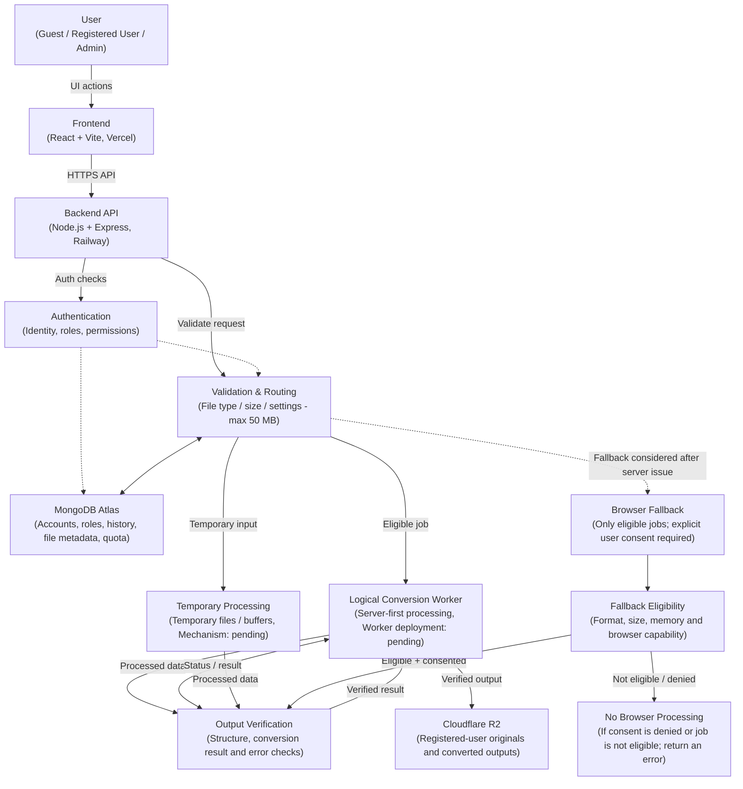

# TRD: FazalDataConverter — Technical Requirements Document

---

## 1. Technical Overview

FazalDataConverter is a web-based data conversion tool that processes Excel, JSON, BSON, and JavaScript files according to supported conversion rules. The system will provide Excel ↔ JSON, Excel ↔ BSON, and supported JavaScript static data extraction, without executing JavaScript code. The application will support server-first processing, consent-based eligible browser fallback, data validation, output verification, file management, and Guest, Registered User, and Admin access. Technical implementation will follow the PRD's approved scope and requirements.

**PRD Reference:** Sections 1, 3, 4, 5, 6, 7, 8, 9, 11, and 12.

---

## 2. Tech Stack

| Layer | Technology | Purpose |
|---|---|---|
| Frontend | React.js | User interface |
| Frontend Build Tool | Vite | Fast development and build |
| Programming Language | JavaScript (ES Modules) | Frontend and backend development |
| Backend Runtime | Node.js LTS | Server-side processing |
| Backend Framework | Express.js | APIs, authentication, and file processing |
| Database | MongoDB Atlas | User accounts, conversion history, and metadata |
| Database ODM | Mongoose | MongoDB models and validation |
| CSS Framework | Tailwind CSS | Responsive UI styling |
| UI Components | shadcn/ui + Radix UI | Accessible UI components |
| Icons | React Icons | Interface icons |
| Routing | React Router | Frontend page navigation |
| API State Management | TanStack Query | API requests, caching, and server state |
| Global State Management | Zustand | Application-wide state management |
| Forms | React Hook Form | Form handling |
| Validation | Zod | Form and API data validation |
| Notifications | Sonner | Success, error, and warning notifications |
| Animation | Framer Motion | UI animations and transitions |
| Data Tables | TanStack Table | Data tables and table interactions |
| Excel Processing | SheetJS + ExcelJS | Excel workbook reading, writing, and supported styling |
| JSON Processing | Native JSON APIs | JSON parsing and serialization |
| BSON Processing | BSON | BSON serialization and deserialization |
| JavaScript Extraction | Acorn + acorn-walk | Static JavaScript data extraction without code execution |
| File Upload | Multer | Backend file upload handling |
| Security | Helmet + bcrypt + express-rate-limit | Security headers, password hashing, and API rate limiting |
| Authentication | google-auth-library + express-session | Google authentication and session management |
| Session Storage | connect-mongo | MongoDB-based session storage |
| Logging | Pino | Application and server logging |
| Testing | Vitest + Supertest + Playwright | Unit, API, and end-to-end testing |
| Code Quality | ESLint + Prettier | Code quality and formatting |
| Package Manager | npm | Dependency management |
| Version Control | Git + GitHub | Source code management |
| Frontend Hosting | Vercel | Frontend deployment |
| Backend Hosting | Railway | Backend deployment |
| Database Hosting | MongoDB Atlas | Managed database hosting |
| File Storage | Cloudflare R2 | Original and converted file storage |
| Runtime Version Policy | Node.js LTS | Stable runtime version |
| Dependency Version Policy | Stable compatible versions + package-lock.json | Dependency version consistency and reproducible installations |

**Implementation Note:** Excel format compatibility, styling preservation, and XLSM VBA preservation must be verified through testing. Exact package versions will be selected during implementation.

---

## 3. System Architecture

### 3.1 Logical System Architecture Diagram


*Note: Dashed path indicates conditional fallback; separate queue/worker deployment is not yet selected.*

### 3.2 System Components & Responsibilities

1. **User Layer (Guest / Registered User / Admin)**
   - Performs UI actions on the web application.
   - Operates within distinct role-based access boundaries.

2. **Frontend (React + Vite, Vercel)**
   - Handles user interface, client-side routing, conversion configuration forms, and UI states.
   - Communicates with the backend API via HTTPS.
   - Deployed on Vercel.

3. **Backend API (Node.js + Express, Railway)**
   - Acts as the central REST API coordinator.
   - Enforces authentication checks and delegates requests to validation and conversion pipelines.
   - Deployed on Railway / Vercel Serverless.

4. **Authentication & Authorization**
   - Manages identity verification, roles, and granular permissions.
   - Connects with MongoDB Atlas for session management and credential verification.

5. **Validation & Routing**
   - Enforces file type, file size (maximum 50 MB), and conversion settings validation.
   - Determines routing:
     - Dispatches eligible jobs to the Logical Conversion Worker.
     - Routes temporary inputs to Temporary Processing buffers.
     - Routes to Browser Fallback conditionally upon server processing failure.

6. **MongoDB Atlas**
   - Persistent store for user accounts, roles, conversion history, file metadata records, consent audit trails, and storage quotas.

7. **Logical Conversion Worker (Server-First Processing)**
   - Performs server-side conversion across Excel, JSON, BSON, and JavaScript static data.
   - Submits processed data to Output Verification.
   - Stores verified outputs into Cloudflare R2 for registered users.
   - Worker deployment strategy is pending implementation benchmarking.

8. **Temporary Processing**
   - Manages temporary file storage and buffers during active conversion workflows.
   - Follows strict automatic cleanup policies after success, failure, or cancellation.

9. **Output Verification**
   - Executes 100% verification coverage over officially supported data elements.
   - Verifies schema, data values, types, metadata integrity, and error classifications before final output generation.

10. **Browser Fallback & Eligibility Flow**
    - **Trigger**: Considered conditionally after server issues arise.
    - **Consent**: Requires explicit user consent before execution.
    - **Eligibility**: Validates format, file size, memory limits, and browser capabilities.
    - **Outcomes**:
      - If eligible and consent is granted: executes conversion and routes to Output Verification.
      - If not eligible or consent is denied: routes to **No Browser Processing** and returns a clear error message.

11. **Cloudflare R2 Storage**
    - Private persistent object storage for registered-user original uploaded files and converted outputs.
    - Direct public bucket access is prohibited; downloads are authorized via backend-generated signed URLs.

### 3.3 Security Architecture
- **Security Headers**: Helmet middleware for HTTP security headers (CSP, HSTS, X-Frame-Options, Referrer-Policy).
- **Password Hashing**: bcrypt for secure password hashing.
- **API Rate Limiting**: express-rate-limit to protect against abuse, brute-force, and DoS attacks.
- **Authentication**: Google OAuth 2.0 via `google-auth-library`.
- **Session Management**: Express-session with persistent MongoDB storage via `connect-mongo`.
- **Input Validation**: Centralized Zod schema validation for all incoming requests and payloads.
- **Output Sanitization**: Prevents cross-site scripting (XSS) and ensures converted files contain no malicious executable code.
- **Access Control**: Strict Role-Based Access Control (RBAC) with Deny-by-Default authorization.

### 3.4 Performance & Scalability Architecture
- **Processing Targets**:
  - Supported files up to 10 MB: Conversion within 10 seconds.
  - Supported files up to 50 MB: Conversion within 60 seconds.
  - Upload and download network times are excluded from target measurements.
- **Job Processing & Queues**: Asynchronous worker-based processing for large and long-running conversion jobs.
- **Cancellation & Retry**: Controls for job cancellation, timeout detection, idempotent request tracking, and safe retry mechanisms.
- **Concurrency & Resource Limits**: Enforced memory and execution duration boundaries tailored for Vercel and Railway environments.

---

## 4. Project Structure

### 4.1 Complete Folder Structure

Below is the proposed complete monorepo structure. Feature-based organization is primary, with centralized folders only for shared infrastructure, configuration, bootstrap, and testing.

```
FazalDataConverter/
│
├── api/
│   └── index.js
│
├── frontend/
│   ├── public/
│   │   ├── favicon.ico
│   │   ├── logo.svg
│   │   ├── robots.txt
│   │   ├── manifest.json
│   │   ├── sitemap.xml
│   │   └── assets/
│   │       ├── images/
│   │       └── icons/
│   │
│   ├── src/
│   │   ├── app/
│   │   │   ├── App.jsx
│   │   │   └── routes.jsx
│   │   │
│   │   ├── components/
│   │   │   ├── ui/
│   │   │   ├── layout/
│   │   │   └── common/
│   │   │
│   │   ├── modules/
│   │   │   ├── auth/
│   │   │   │   ├── LoginPage.jsx
│   │   │   │   ├── GoogleLoginButton.jsx
│   │   │   │   ├── AuthLayout.jsx
│   │   │   │   ├── AuthGuard.jsx
│   │   │   │   ├── auth.api.js
│   │   │   │   ├── auth.store.js
│   │   │   │   ├── auth.validation.js
│   │   │   │   ├── auth.constants.js
│   │   │   │   ├── auth.utils.js
│   │   │   │   └── useAuth.js
│   │   │   │
│   │   │   ├── converter/
│   │   │   │   ├── ConverterPage.jsx
│   │   │   │   ├── ConverterLayout.jsx
│   │   │   │   ├── ConverterForm.jsx
│   │   │   │   ├── FileUpload.jsx
│   │   │   │   ├── ConversionOptions.jsx
│   │   │   │   ├── SheetSelector.jsx
│   │   │   │   ├── ConversionProgress.jsx
│   │   │   │   ├── ConversionResult.jsx
│   │   │   │   ├── ConversionError.jsx
│   │   │   │   ├── BrowserFallbackConsent.jsx
│   │   │   │   ├── converter.api.js
│   │   │   │   ├── converter.store.js
│   │   │   │   ├── converter.validation.js
│   │   │   │   ├── converter.constants.js
│   │   │   │   ├── converter.utils.js
│   │   │   │   └── useConverter.js
│   │   │   │
│   │   │   ├── history/
│   │   │   │   ├── HistoryPage.jsx
│   │   │   │   ├── HistoryList.jsx
│   │   │   │   ├── HistoryDetails.jsx
│   │   │   │   ├── history.api.js
│   │   │   │   ├── history.store.js
│   │   │   │   ├── history.constants.js
│   │   │   │   └── useHistory.js
│   │   │   │
│   │   │   ├── account/
│   │   │   │   ├── AccountPage.jsx
│   │   │   │   ├── AccountLayout.jsx
│   │   │   │   ├── ProfileSection.jsx
│   │   │   │   ├── StorageUsage.jsx
│   │   │   │   ├── DeleteAccountDialog.jsx
│   │   │   │   ├── account.api.js
│   │   │   │   ├── account.store.js
│   │   │   │   ├── account.validation.js
│   │   │   │   ├── account.constants.js
│   │   │   │   └── useAccount.js
│   │   │   │
│   │   │   └── admin/
│   │   │       ├── AdminPage.jsx
│   │   │       ├── AdminLayout.jsx
│   │   │       ├── AdminDashboard.jsx
│   │   │       ├── UserManagement.jsx
│   │   │       ├── ConversionMonitoring.jsx
│   │   │       ├── ReportsManagement.jsx
│   │   │       ├── SecurityLogs.jsx
│   │   │       ├── AuditLogs.jsx
│   │   │       ├── MaintenanceSettings.jsx
│   │   │       ├── AdminGuard.jsx
│   │   │       ├── admin.api.js
│   │   │       ├── admin.store.js
│   │   │       ├── admin.validation.js
│   │   │       ├── admin.constants.js
│   │   │       └── useAdmin.js
│   │   │
│   │   ├── services/
│   │   │   └── api.client.js
│   │   │
│   │   ├── config/
│   │   │   └── frontend.config.js
│   │   │
│   │   ├── validations/
│   │   │   └── common.validation.js
│   │   │
│   │   ├── assets/
│   │   │   ├── images/
│   │   │   ├── icons/
│   │   │   ├── fonts/
│   │   │   └── illustrations/
│   │   │
│   │   ├── styles/
│   │   │   ├── globals.css
│   │   │   ├── themes.css
│   │   │   └── utilities.css
│   │   │
│   │   └── main.jsx
│   │
│   ├── .env.local
│   ├── index.html
│   ├── vite.config.js
│   └── package.json
│
├── backend/
│   ├── src/
│   │   ├── app.js
│   │   ├── server.js
│   │   │
│   │   ├── core/
│   │   │   ├── database/
│   │   │   │   ├── database.connection.js
│   │   │   │   ├── database.config.js
│   │   │   │   └── database.utils.js
│   │   │   │
│   │   │   ├── middleware/
│   │   │   │   ├── authentication.middleware.js
│   │   │   │   ├── authorization.middleware.js
│   │   │   │   ├── rate-limit.middleware.js
│   │   │   │   └── request.middleware.js
│   │   │   │
│   │   │   ├── security/
│   │   │   │   ├── security.config.js
│   │   │   │   └── security.utils.js
│   │   │   │
│   │   │   ├── logger/
│   │   │   │   ├── logger.config.js
│   │   │   │   └── logger.service.js
│   │   │   │
│   │   │   ├── errors/
│   │   │   │   ├── error-handler.middleware.js
│   │   │   │   ├── application.error.js
│   │   │   │   └── error.utils.js
│   │   │   │
│   │   │   ├── config/
│   │   │   │   ├── backend.config.js
│   │   │   │   └── environment.validation.js
│   │   │   │
│   │   │   ├── validation/
│   │   │   │   └── validation.utils.js
│   │   │   │
│   │   │   ├── queue/
│   │   │   │   ├── queue.config.js
│   │   │   │   └── queue.manager.js
│   │   │   │
│   │   │   └── utils/
│   │   │       ├── response.utils.js
│   │   │       └── common.utils.js
│   │   │
│   │   └── modules/
│   │       ├── auth/
│   │       │   ├── auth.routes.js
│   │       │   ├── auth.controller.js
│   │       │   ├── auth.service.js
│   │       │   ├── google-auth.service.js
│   │       │   ├── user.model.js
│   │       │   ├── session.model.js
│   │       │   ├── auth.validation.js
│   │       │   ├── auth.middleware.js
│   │       │   ├── auth.constants.js
│   │       │   └── auth.utils.js
│   │       │
│   │       ├── converter/
│   │       │   ├── converter.routes.js
│   │       │   ├── converter.controller.js
│   │       │   ├── converter.service.js
│   │       │   ├── conversion.model.js
│   │       │   ├── conversion.queue.js
│   │       │   ├── conversion.worker.js
│   │       │   ├── converter.validation.js
│   │       │   ├── converter.constants.js
│   │       │   └── converter.utils.js
│   │       │
│   │       ├── conversion-engine/
│   │       │   ├── conversion-engine.service.js
│   │       │   ├── conversion-workflow.service.js
│   │       │   ├── conversion-output.service.js
│   │       │   └── conversion-engine.constants.js
│   │       │
│   │       ├── file-processing/
│   │       │   ├── file-processing.controller.js
│   │       │   ├── file-processing.service.js
│   │       │   ├── file-validation.service.js
│   │       │   ├── format-detection.service.js
│   │       │   ├── metadata-extraction.service.js
│   │       │   └── file-processing.utils.js
│   │       │
│   │       ├── format-handlers/
│   │       │   ├── excel/
│   │       │   │   ├── excel.handler.js
│   │       │   │   ├── excel.reader.js
│   │       │   │   ├── excel.writer.js
│   │       │   │   └── excel.utils.js
│   │       │   │
│   │       │   ├── json/
│   │       │   │   ├── json.handler.js
│   │       │   │   ├── json.reader.js
│   │       │   │   └── json.writer.js
│   │       │   │
│   │       │   ├── bson/
│   │       │   │   ├── bson.handler.js
│   │       │   │   ├── bson.reader.js
│   │       │   │   └── bson.writer.js
│   │       │   │
│   │       │   └── javascript/
│   │       │       ├── javascript.handler.js
│   │       │       ├── javascript.parser.js
│   │       │       └── javascript.extractor.js
│   │       │
│   │       ├── output-verification/
│   │       │   ├── output-verification.service.js
│   │       │   └── output-verification.utils.js
│   │       │
│   │       ├── storage/
│   │       │   ├── storage.routes.js
│   │       │   ├── storage.controller.js
│   │       │   ├── storage.service.js
│   │       │   ├── upload.service.js
│   │       │   ├── output-storage.service.js
│   │       │   ├── download.service.js
│   │       │   ├── cleanup.service.js
│   │       │   ├── cleanup.queue.js
│   │       │   ├── cleanup.worker.js
│   │       │   ├── cloudflare-r2.service.js
│   │       │   └── storage.constants.js
│   │       │
│   │       ├── history/
│   │       │   ├── history.routes.js
│   │       │   ├── history.controller.js
│   │       │   ├── history.service.js
│   │       │   ├── history.model.js
│   │       │   ├── history.validation.js
│   │       │   └── history.constants.js
│   │       │
│   │       ├── account/
│   │       │   ├── account.routes.js
│   │       │   ├── account.controller.js
│   │       │   ├── account.service.js
│   │       │   ├── account.model.js
│   │       │   ├── account.validation.js
│   │       │   └── account.constants.js
│   │       │
│   │       └── admin/
│   │           ├── admin.routes.js
│   │           ├── admin.controller.js
│   │           ├── admin.service.js
│   │           ├── admin-audit.model.js
│   │           ├── admin.validation.js
│   │           ├── admin.middleware.js
│   │           ├── admin.constants.js
│   │           └── admin.utils.js
│   │
│   ├── .env
│   └── package.json
│
├── shared/
│   ├── modules/
│   │   ├── auth/
│   │   ├── converter/
│   │   ├── history/
│   │   └── storage/
│   │
│   ├── constants/
│   ├── utils/
│   ├── validators/
│   ├── schemas/
│   └── package.json
│
├── bootstrap/
│   ├── frontend/
│   │   ├── frontend.bootstrap.js
│   │   ├── frontend.initialize.js
│   │   └── frontend.providers.jsx
│   │
│   ├── backend/
│   │   ├── backend.bootstrap.js
│   │   ├── database.bootstrap.js
│   │   ├── middleware.bootstrap.js
│   │   └── routes.bootstrap.js
│   │
│   └── bootstrap.config.js
│
├── tests/
│   ├── frontend/
│   │   ├── auth/
│   │   ├── converter/
│   │   ├── history/
│   │   ├── account/
│   │   └── admin/
│   │
│   ├── backend/
│   │   ├── auth/
│   │   ├── converter/
│   │   ├── conversion-engine/
│   │   ├── file-processing/
│   │   ├── storage/
│   │   ├── history/
│   │   ├── account/
│   │   └── admin/
│   │
│   └── e2e/
│       ├── authentication/
│       ├── conversion/
│       ├── history/
│       ├── account/
│       ├── admin/
│       └── security/
│
├── config/
│   ├── environment.config.js
│   └── environment.validation.js
│
├── scripts/
│   ├── development/
│   │   ├── start-frontend.js
│   │   └── start-backend.js
│   │
│   ├── database/
│   │   ├── database-check.js
│   │   ├── database-backup.js
│   │   ├── database-seed.js
│   │   ├── create-admin.js
│   │   └── migrations/
│   │
│   ├── deployment/
│   │   └── deployment-check.js
│   │
│   ├── maintenance/
│   │   └── cleanup.js
│   │
│   ├── testing/
│   │   └── test-runner.js
│   │
│   └── utilities/
│       └── verify-env.js
│
├── docs/
│   ├── PRD.docx
│   └── TRD.docx
│
├── logs/
│   ├── application/
│   ├── errors/
│   ├── security/
│   └── audit/
│
├── backend/
│   └── storage/
│       ├── temp/
│       ├── processing/
│       └── quarantine/
│
├── .env.example
├── .gitignore
├── .editorconfig
├── .prettierrc
├── .prettierignore
├── eslint.config.js
├── vercel.json
├── package.json
├── package-lock.json
└── README.md
```

### 4.2 Folder Structure — Short Notes

### 4.3 Important Architecture Rules

- **Feature ownership:** Each major feature's frontend and backend code will reside in its respective module.
- **Flat feature structure:** Unnecessary `components/`, `services/`, `hooks/` subfolders will not be created inside normal feature modules.
- **Format handlers:** Dedicated subfolders for Excel, JSON, BSON, and JavaScript will exist because their processing logic is complex.
- **Testing:** Tests will reside only in the centralized `tests/` folder; no duplicate test files in source modules.
- **Database:** Mongoose models will reside in respective backend feature folders.
- **Authentication:** Google Login for Registered Users; email/password authentication for the single Admin.
- **JavaScript safety:** Submitted JavaScript functions or dynamic code will not be executed; only approved static data extraction is supported.
- **Environment:** Frontend and backend environment variables will be kept separate. Secrets will not be exposed in frontend or shared modules.
- **API:** Non-versioned feature-based endpoints — `/api/auth`, `/api/converter`, `/api/history`, `/api/account`, `/api/admin`.
- **Deployment:** Single Vercel project; a separate hosting service is not currently planned.
- **Code quality:** Root ESLint, Prettier, and EditorConfig configuration for the entire monorepo.
- **Naming:** React components use PascalCase `.jsx`; backend files use role-based `.js`; hooks use `useName.js`; tests use `.test.js` / `.test.jsx`.

### 4.4 Important Vercel Implementation Considerations

A technical limitation must be clearly mentioned in the TRD:

- Vercel Functions have a normal request/response body limit of 4.5 MB. As of the November 20, 2026 update, a 20 MiB request body public beta is available, but requires 4 GB Performance memory and opt-in. Therefore, the PRD's 50 MB file upload target cannot be assumed via direct API upload. A Cloudflare R2 direct upload flow must be used.
- An Express application can be deployed as a Function on Vercel. Instead of serving frontend assets via `express.static()`, Vercel static deployment will be used.
- Vercel Function's temporary filesystem is not permanent storage. `backend/storage/` will remain for the development structure; in the deployed environment, `/tmp` will be used for temporary processing and Cloudflare R2 for permanent files.
- Given Vercel Hobby plan's execution duration and resource limits, a future worker solution may be needed for long-running conversions.
- Production security/audit logs must not depend on the local `logs/` directory. Persistent database or suitable durable log storage is needed for the PRD's one-year retention rules.

### 4.5 Final Folder Structure Decision

**Section 4 Complete.**

The Project Structure is now ready to be finalized. Extra documentation folders, Railway deployment configuration, and unnecessary architectural layers have not been included.

---

## 5. Frontend Design

The frontend will be based on React.js, JavaScript ES Modules, and Vite. The frontend will be organized using feature-based architecture. It will handle application structure, state management, routing, validation, API communication, and browser-based processing.

### 5.1 Application Structure

- The React.js application will be built and run through Vite.
- The main entry point will be `frontend/src/main.jsx`.
- Application setup and central route registration will reside in `frontend/src/app/`.
- Feature-specific screens and logic will be organized in `frontend/src/modules/`.
- Reusable UI components will be kept in `frontend/src/components/`.

### 5.2 State Management

- State management will be feature-based and requirement-oriented.
- Features such as Converter, Authentication, History, and Admin will manage their own relevant state.
- React Hooks and Context API will be used as needed.
- Component-specific state will be limited to that component.
- Redux or any additional global state library is not currently considered necessary.

### 5.3 Routing and Access Control

- React Router will be used for application routing.
- Feature routes will be registered in a central route configuration.
- Role-based page access will be managed for Guest, Registered User, and Admin.
- Protected routes will prevent unauthorized users from accessing restricted frontend pages.
- Actual authentication and authorization checks will be enforced on the backend; frontend checks are not a replacement for security.

### 5.4 Form and Data Validation

- Common frontend validation rules will be kept in `frontend/src/validations/`.
- Feature-specific validation will reside in the related feature module.
- Reusable cross-platform validation rules can be kept in `shared/validators/` as needed.
- Initial validation of file type, file size, required fields, and conversion options will occur on the frontend.
- Independent validation will be performed again on the backend; frontend validation is not considered the final security check.

### 5.5 API Communication

- A common HTTP client for backend communication will be kept in `frontend/src/services/api.client.js`.
- API base URL and network-related configuration will be centralized.
- Feature-specific API requests will be organized in their respective feature modules.
- Authentication credentials and session-related data will be managed according to secure handling requirements.
- Loading states, API responses, and errors will be handled with consistent frontend behavior.

### 5.6 Browser-Based Processing

- Backend processing will be the primary approach for conversion.
- Browser-based processing will be used only as a fallback based on eligible conversion formats, file sizes, and browser capabilities.
- Before browser fallback when server processing is unavailable or unsuitable, explicit user consent will be obtained.
- If the user denies consent, browser-based processing will not start.
- Functions or dynamic expressions in submitted JavaScript files will not be executed; only approved static data extraction is supported.

### 5.7 Frontend UI and Styling

- **Tailwind CSS** will be used for core utility styling, extended with the unified design tokens.
- **shadcn/ui and Radix UI** will provide accessible, unstyled component primitives customized to project design tokens.
- **Inter** is the exclusive font family across the entire application; Plus Jakarta Sans is completely removed.
- **React Icons** will provide consistent iconography aligned with token colors.
- Global styles and theme tokens will reside in `frontend/src/styles/globals.css` and `themes.css`.
- Feature-specific micro-components will reside in their respective feature modules; UI will strictly adhere to responsive breakpoints and WCAG 2.2 AA accessibility requirements.

### 5.8 Global Colour & Visual Design Token System

The entire FazalDataConverter frontend adheres to a unified, premium SaaS visual design language combining Apple-inspired white minimalism with Google Antigravity futuristic gradients.

#### 5.8.1 Primary Brand Palette

| Token | HEX | RGBA | Usage |
|---|---|---|---|
| Primary | #5145E5 | rgba(81, 69, 229, 1) | Main brand colour |
| Primary Deep | #3730A3 | rgba(55, 48, 163, 1) | Deep emphasis |
| Primary Dark | #4338CA | rgba(67, 56, 202, 1) | Hover and active states |
| Primary Bright | #6366F1 | rgba(99, 102, 241, 1) | Highlights |
| Primary Light | #818CF8 | rgba(129, 140, 248, 1) | Soft accents |
| Primary Soft | #EEF2FF | rgba(238, 242, 255, 1) | Light backgrounds |
| Primary Surface | #E0E7FF | rgba(224, 231, 255, 1) | Selected surfaces |
| Primary Border | #C7D2FE | rgba(199, 210, 254, 1) | Highlighted borders |

#### 5.8.2 Secondary Brand Palette

| Token | HEX | RGBA | Usage |
|---|---|---|---|
| Secondary | #7C3AED | rgba(124, 58, 237, 1) | Secondary brand accent |
| Secondary Deep | #5B21B6 | rgba(91, 33, 182, 1) | Deep violet |
| Secondary Dark | #6D28D9 | rgba(109, 40, 217, 1) | Hover states |
| Secondary Bright | #9333EA | rgba(147, 51, 234, 1) | Accent highlights |
| Secondary Light | #A78BFA | rgba(167, 139, 250, 1) | Soft violet accents |
| Secondary Soft | #F5F0FF | rgba(245, 240, 255, 1) | Violet background |
| Secondary Surface | #EDE9FE | rgba(237, 233, 254, 1) | Selected violet surface |
| Secondary Border | #DDD6FE | rgba(221, 214, 254, 1) | Violet borders |

#### 5.8.3 Supporting Accent Colours
- **Blue Palette:** Blue `#3B82F6` (rgba(59, 130, 246, 1)), Blue Deep `#1D4ED8` (rgba(29, 78, 216, 1)), Blue Light `#93C5FD` (rgba(147, 197, 253, 1)), Blue Soft `#EFF6FF` (rgba(239, 246, 255, 1)), Blue Border `#BFDBFE` (rgba(191, 219, 254, 1)).
- **Cyan Palette:** Cyan `#06B6D4` (rgba(6, 182, 212, 1)), Cyan Deep `#0891B2` (rgba(8, 145, 178, 1)), Cyan Light `#67E8F9` (rgba(103, 232, 249, 1)), Cyan Soft `#ECFEFF` (rgba(236, 254, 255, 1)), Cyan Border `#A5F3FC` (rgba(165, 243, 252, 1)).
- **Pink Palette:** Pink `#EC4899` (rgba(236, 72, 153, 1)), Pink Deep `#DB2777` (rgba(219, 39, 119, 1)), Pink Light `#F9A8D4` (rgba(249, 168, 212, 1)), Pink Soft `#FDF2F8` (rgba(253, 242, 248, 1)), Pink Border `#FBCFE8` (rgba(251, 207, 232, 1)).

#### 5.8.4 Global Backgrounds & Surfaces

| Token | HEX | RGBA | Usage |
|---|---|---|---|
| App Background | #F8F9FC | rgba(248, 249, 252, 1) | Main application background |
| Main Canvas | #F8F9FC | rgba(248, 249, 252, 1) | Main workspace |
| Primary Surface | #FFFFFF | rgba(255, 255, 255, 1) | Main content surfaces |
| Secondary Surface | #F5F6FC | rgba(245, 246, 252, 1) | Secondary sections |
| Tertiary Surface | #F0F2F8 | rgba(240, 242, 248, 1) | Subtle grouped areas |
| Cool Surface | #F0F3FF | rgba(240, 243, 255, 1) | Cool-toned highlights |
| Violet Surface | #F6F1FF | rgba(246, 241, 255, 1) | Violet highlights |
| Muted Surface | #F3F4F6 | rgba(243, 244, 246, 1) | Disabled or muted areas |
| Inverse Surface | #151525 | rgba(21, 21, 37, 1) | Dark inverse elements |

*Rules:* Main pages use `#F8F9FC`. Cards, dialogs, tables, and forms primarily use white (`#FFFFFF`). Soft tinted backgrounds are used selectively.

#### 5.8.5 Typography & Text Colours

| Token | HEX | RGBA | Usage |
|---|---|---|---|
| Text Primary | #151525 | rgba(21, 21, 37, 1) | Main headings and content |
| Text Secondary | #55566F | rgba(85, 86, 111, 1) | Descriptions and subtext |
| Text Muted | #85869B | rgba(133, 134, 155, 1) | Supporting text |
| Text Subtle | #A1A1B5 | rgba(161, 161, 181, 1) | Placeholders and tertiary text |
| Text Disabled | #B8BAC9 | rgba(184, 186, 201, 1) | Disabled text |
| Text Inverse | #FFFFFF | rgba(255, 255, 255, 1) | Text on dark surfaces |
| Text Primary Brand | #5145E5 | rgba(81, 69, 229, 1) | Brand links and emphasis |
| Text Secondary Brand | #7C3AED | rgba(124, 58, 237, 1) | Secondary emphasis |
| Text Link | #4F46E5 | rgba(79, 70, 229, 1) | Interactive links |
| Text Link Hover | #3730A3 | rgba(55, 48, 163, 1) | Link hover state |

#### 5.8.6 Button System
- **Primary Button:** Background `#5145E5`, Hover `#4338CA`, Active `#3730A3`, Text `#FFFFFF`, Border `#5145E5`, Focus Ring `#A5B4FC`, Disabled `#E5E7EB` (Text `#9CA3AF`).
- **Secondary Button:** Background `#FFFFFF`, Hover `#F5F6FC`, Active `#EEF2FF`, Text `#3730A3`, Border `#E6E8F0`, Hover Border `#C7D2FE`.
- **Outline Button:** Background `#FFFFFF`, Text `#5145E5`, Border `#C7D2FE`, Hover Background `#EEF2FF`, Hover Border `#818CF8`.
- **Ghost Button:** Background transparent, Hover `#F5F6FC`, Active `#EEF2FF`, Text `#55566F`, Hover Text `#3730A3`.
- **Destructive Button:** Background `#DC2626`, Hover `#B91C1C`, Active `#991B1B`, Text `#FFFFFF`, Disabled `#FECACA`.
- **Gradient Button (Primary CTAs):**
  - Background: `linear-gradient(120deg, #4F46E5 0%, #7C3AED 48%, #A855F7 100%)`
  - Hover: `linear-gradient(120deg, #4338CA 0%, #6D28D9 48%, #9333EA 100%)`
  - Active: `linear-gradient(120deg, #3730A3 0%, #5B21B6 48%, #7E22CE 100%)`
  - Text: `#FFFFFF`, Border: `transparent`.

#### 5.8.7 Input, Form, and Select Colours
- **Input Field:** Background `#FFFFFF`, Text `#151525`, Placeholder `#85869B`, Border `#E6E8F0`, Hover Border `#C5C8D8`, Focus Border `#6366F1`, Focus Ring `#C7D2FE`, Error Border `#EF4444`, Error Background `#FEF2F2`, Success Border `#10B981`, Disabled Background `#F3F4F6`.
- **Dropdown / Select:** Background `#FFFFFF`, Text `#151525`, Border `#E6E8F0`, Hover Item `#F5F6FC`, Selected Item `#EEF2FF` (Text `#3730A3`), Separator `#E6E8F0`.
- **Checkbox / Radio:** Unselected Background `#FFFFFF`, Unselected Border `#C5C8D8`, Selected Background `#5145E5`, Selected Icon `#FFFFFF`, Focus Ring `#C7D2FE`, Disabled Background `#E5E7EB`.

#### 5.8.8 Cards, Dialogs, Tables, and Navigation
- **Cards & Boxes:** Background `#FFFFFF`, Secondary `#F5F6FC`, Highlight `#EEF2FF`, Border `#E6E8F0`, Hover Border `#C7D2FE`, Title `#151525`, Description `#55566F`.
- **Dialogs & Modals:** Background `#FFFFFF`, Border `#E6E8F0`, Title `#151525`, Description `#55566F`, Overlay `rgba(21, 21, 37, 0.50)` (`#15152580`).
- **Tables & Data Grids:** Background `#FFFFFF`, Header Background `#F8F9FC`, Header Text `#55566F`, Body Text `#151525`, Secondary Text `#85869B`, Border `#E6E8F0`, Row Hover `#F8F9FC`, Selected Row `#EEF2FF` (Text `#3730A3`).
- **Sidebar & Navigation:** Background `#FFFFFF`, Border `#E6E8F0`, Text `#55566F`, Icon `#85869B`, Hover Background `#F5F6FC` (Text `#3730A3`), Active Background `#EEF2FF` (Text `#5145E5`, Icon `#5145E5`).

#### 5.8.9 Badges, Alerts, and Dropzones
- **Status Badges:**
  - Success: Background `#ECFDF5`, Text `#047857`, Border `#A7F3D0`, Icon `#10B981`.
  - Warning: Background `#FFFBEB`, Text `#B45309`, Border `#FDE68A`, Icon `#F59E0B`.
  - Error/Failed: Background `#FEF2F2`, Text `#B91C1C`, Border `#FECACA`, Icon `#EF4444`.
  - Information: Background `#EFF6FF`, Text `#1D4ED8`, Border `#BFDBFE`, Icon `#3B82F6`.
  - Processing: Background `#EEF2FF`, Text `#4338CA`, Border `#C7D2FE`, Icon `#6366F1`.
  - Neutral: Background `#F3F4F6`, Text `#4B5563`, Border `#E5E7EB`, Icon `#6B7280`.
- **Alerts & Toast Notifications:**
  - Success Alert: `#ECFDF5` / `#065F46` / Border `#A7F3D0`. Toast: `#047857` with white text.
  - Warning Alert: `#FFFBEB` / `#92400E` / Border `#FDE68A`. Toast: `#92400E` with white text.
  - Error Alert: `#FEF2F2` / `#991B1B` / Border `#FECACA`. Toast: `#B91C1C` with white text.
  - Info Alert: `#EFF6FF` / `#1E40AF` / Border `#BFDBFE`. Toast: `#3730A3` with white text.
- **File Upload Dropzone:** Default Background `#F6F5FF`, Border `#C7D2FE`, Text `#3730A3`, Icon `#6366F1`. Hover: `#EEF2FF` / `#818CF8`. Drag Active: `#E0E7FF` / `#5145E5`.
- **Progress Bar:** Track `#E6E8F0`, Fill `#5145E5`, Highlight `#A78BFA`, Indicator `#6366F1`. Optional Gradient: `linear-gradient(90deg, #4F46E5 0%, #7C3AED 55%, #06B6D4 100%)`.

#### 5.8.10 Shadows & Approved Gradients
- **Shadows:**
  - Card: `0 2px 8px rgba(21, 21, 37, 0.04)`
  - Card Hover: `0 8px 24px rgba(21, 21, 37, 0.08)`
  - Panel: `0 12px 32px rgba(21, 21, 37, 0.08)`
  - Dialog: `0 24px 64px rgba(21, 21, 37, 0.16)`
  - Dropdown: `0 8px 24px rgba(21, 21, 37, 0.10)`
  - Brand Ambient: `0 8px 32px rgba(81, 69, 229, 0.16)`
  - Violet Ambient: `0 8px 32px rgba(124, 58, 237, 0.14)`
  - Focus Ring: `0 0 0 4px rgba(99, 102, 241, 0.16)`
- **Gradient Library:**
  - Gradient 1 (Signature Brand): `linear-gradient(120deg, #4F46E5 0%, #7C3AED 48%, #A855F7 100%)`
  - Gradient 2 (Electric Blue Violet): `linear-gradient(135deg, #2563EB 0%, #6366F1 48%, #9333EA 100%)`
  - Gradient 3 (Aurora): `linear-gradient(120deg, #6366F1 0%, #8B5CF6 35%, #D946EF 68%, #38BDF8 100%)`
  - Gradient 4 (Soft Lavender): `linear-gradient(135deg, #EEF2FF 0%, #F5F0FF 55%, #FDF2F8 100%)`
  - Gradient 5 (Ice Blue): `linear-gradient(135deg, #EFF6FF 0%, #ECFEFF 50%, #F0FDFA 100%)`
  - Gradient 6 (Deep Premium): `linear-gradient(135deg, #312E81 0%, #4F46E5 50%, #7C3AED 100%)`
  - Gradient 7 (Indigo Cyan): `linear-gradient(120deg, #4F46E5 0%, #3B82F6 55%, #06B6D4 100%)`
  - Gradient 8 (Violet Pink): `linear-gradient(120deg, #7C3AED 0%, #A855F7 55%, #EC4899 100%)`
  - Gradient 9 (White Lavender): `linear-gradient(180deg, #FFFFFF 0%, #F8F9FC 100%)`
  - Gradient 10 (Ambient Glow): `radial-gradient(ellipse at top left, rgba(99, 102, 241, 0.12) 0%, rgba(99, 102, 241, 0) 55%)`

### 5.9 Complete CSS Variable Design Token Implementation

The global stylesheet (`frontend/src/styles/globals.css`) defines the standard root variables:

```css
:root {
  /* Primary */
  --color-primary: #5145E5;
  --color-primary-deep: #3730A3;
  --color-primary-dark: #4338CA;
  --color-primary-bright: #6366F1;
  --color-primary-light: #818CF8;
  --color-primary-soft: #EEF2FF;
  --color-primary-surface: #E0E7FF;
  --color-primary-border: #C7D2FE;

  /* Secondary */
  --color-secondary: #7C3AED;
  --color-secondary-deep: #5B21B6;
  --color-secondary-dark: #6D28D9;
  --color-secondary-bright: #9333EA;
  --color-secondary-light: #A78BFA;
  --color-secondary-soft: #F5F0FF;
  --color-secondary-surface: #EDE9FE;
  --color-secondary-border: #DDD6FE;

  /* Accents */
  --color-blue: #3B82F6;
  --color-cyan: #06B6D4;
  --color-pink: #EC4899;

  /* Backgrounds */
  --color-background: #F8F9FC;
  --color-surface: #FFFFFF;
  --color-surface-secondary: #F5F6FC;
  --color-surface-tertiary: #F0F2F8;
  --color-surface-cool: #F0F3FF;
  --color-surface-violet: #F6F1FF;
  --color-surface-inverse: #151525;

  /* Text */
  --color-text-primary: #151525;
  --color-text-secondary: #55566F;
  --color-text-muted: #85869B;
  --color-text-subtle: #A1A1B5;
  --color-text-disabled: #B8BAC9;
  --color-text-inverse: #FFFFFF;
  --color-text-link: #4F46E5;

  /* Borders */
  --color-border: #E6E8F0;
  --color-border-strong: #D5D8E6;
  --color-border-subtle: #F0F1F5;
  --color-border-focus: #6366F1;
  --color-border-selected: #C7D2FE;

  /* Semantic */
  --color-success: #10B981;
  --color-success-bg: #ECFDF5;
  --color-success-text: #047857;

  --color-warning: #F59E0B;
  --color-warning-bg: #FFFBEB;
  --color-warning-text: #B45309;

  --color-error: #EF4444;
  --color-error-bg: #FEF2F2;
  --color-error-text: #B91C1C;

  --color-info: #3B82F6;
  --color-info-bg: #EFF6FF;
  --color-info-text: #1D4ED8;

  /* Buttons */
  --button-primary-bg: #5145E5;
  --button-primary-hover: #4338CA;
  --button-primary-active: #3730A3;
  --button-primary-text: #FFFFFF;

  --button-secondary-bg: #FFFFFF;
  --button-secondary-hover: #F5F6FC;
  --button-secondary-text: #3730A3;

  --button-danger-bg: #DC2626;
  --button-danger-hover: #B91C1C;
  --button-danger-text: #FFFFFF;

  /* Gradients */
  --gradient-brand: linear-gradient(120deg, #4F46E5 0%, #7C3AED 48%, #A855F7 100%);
  --gradient-electric: linear-gradient(135deg, #2563EB 0%, #6366F1 48%, #9333EA 100%);
  --gradient-aurora: linear-gradient(120deg, #6366F1 0%, #8B5CF6 35%, #D946EF 68%, #38BDF8 100%);
  --gradient-soft-lavender: linear-gradient(135deg, #EEF2FF 0%, #F5F0FF 55%, #FDF2F8 100%);
  --gradient-ice-blue: linear-gradient(135deg, #EFF6FF 0%, #ECFEFF 50%, #F0FDFA 100%);
  --gradient-deep-premium: linear-gradient(135deg, #312E81 0%, #4F46E5 50%, #7C3AED 100%);
  --gradient-indigo-cyan: linear-gradient(120deg, #4F46E5 0%, #3B82F6 55%, #06B6D4 100%);

  /* Overlay */
  --overlay-dialog: rgba(21, 21, 37, 0.50);

  /* Shadows */
  --shadow-card: 0 2px 8px rgba(21, 21, 37, 0.04);
  --shadow-card-hover: 0 8px 24px rgba(21, 21, 37, 0.08);
  --shadow-panel: 0 12px 32px rgba(21, 21, 37, 0.08);
  --shadow-dialog: 0 24px 64px rgba(21, 21, 37, 0.16);
  --shadow-brand: 0 8px 32px rgba(81, 69, 229, 0.16);
  --shadow-focus: 0 0 0 4px rgba(99, 102, 241, 0.16);
}
```

### 5.10 Unified Typography System (Inter Only)

**Inter is the sole, universal font family across the entire codebase.** Plus Jakarta Sans is completely excised from HTML headers, Tailwind configurations, and CSS rules.

#### A. Typography Scale Table

| Style | Font Family | Size | Weight | Line Height | Letter Spacing |
|---|---|---:|---:|---:|---:|
| Display Large | Inter | 36px | 700 | 44px | -0.02em |
| Display Large Mobile | Inter | 28px | 700 | 36px | -0.02em |
| Headline Large | Inter | 28px | 600 | 36px | -0.015em |
| Headline Medium | Inter | 22px | 600 | 30px | -0.01em |
| Headline Small | Inter | 18px | 600 | 26px | -0.005em |
| Body Large | Inter | 16px | 400 | 24px | Normal |
| Body Medium | Inter | 14px | 400 | 20px | Normal |
| Body Small | Inter | 13px | 400 | 18px | Normal |
| Label Large | Inter | 14px | 500 | 20px | 0.005em |
| Label Medium | Inter | 12px | 500 | 16px | 0.02em |
| Label Small | Inter | 11px | 600 | 14px | 0.04em |

#### B. Implementation Rules
1. **Font Loading:** Load `Inter:wght@400;500;600;700;800` via Vite Google Font preconnect or local font package.
2. **Tailwind Config:** Set `fontFamily.sans = ['Inter', 'sans-serif']`. Remove any definition of `Plus Jakarta Sans`.
3. **Tabular Figures:** Apply `font-feature-settings: 'tnum' 1;` (`font-variant-numeric: tabular-nums`) on all data tables, timers, counters, file size badges, and row index columns.
4. **Contrast Compliance:** Guarantee minimum 4.5:1 text-to-surface contrast for normal text and 3:1 for large display text per WCAG 2.2 AA.

### 5.11 Figma Screen Architecture & Component Alignment

Based on analysis of the complete UI screen archive (`FIGMA.zip`), all 16 screen templates are mapped to the unified design tokens and component structure:

1. **Authentication Screen (`sign_in/code.html`):**
   - Clean `#F8F9FC` background with subtle ambient glow (`Gradient 10`).
   - Centered `#FFFFFF` card (`--shadow-dialog`), Google Login button with custom brand styling, and Admin toggle.
2. **Main Converter Workspace (`converter/code.html`):**
   - Dual conversion direction switcher (`Excel to JSON` vs `JSON to Excel`) with active pill `--color-primary-soft` and `--color-primary`.
   - File Upload Dropzone utilizing `--color-primary-soft`, `--color-primary-border`, and responsive drag-active animation.
   - Mode toggles: `Normal Data JSON` vs `Workbook JSON`.
   - Primary action using Gradient 1 (`--gradient-brand`) button.
3. **Sheet Selection Modal (`sheet_selection_modal/code.html`):**
   - Multi-sheet selection modal with select all / individual checkboxes, sheet dimension badges, and primary confirmation button.
4. **Conversion Progress State (`conversion_progress_processing_state/code.html`):**
   - Real-time animated progress bar (`--color-primary` fill with gradient shimmer), step indicators, and cancellation button.
5. **Validation Error Report (`conversion_validation_error_report/code.html`):**
   - Structured error panel with error code chips (`--color-error`), cell references, and manual inline correction triggers.
6. **Browser Fallback Consent Dialog (`browser_fallback_consent_dialog/code.html`):**
   - Warning modal (`--color-warning-bg`, `--color-warning-text`) requesting user confirmation for client-side processing fallback.
7. **User Account Page (`account/code.html`):**
   - Profile summary, storage quota progress bar (1 GB limit indicator), and active multi-device session list.
8. **Account Self-Deletion Re-Auth Modal (`account_self_deletion_re_auth_modal/code.html`):**
   - Destructive dialog with explicit confirmation checkbox and Google re-authentication flow.
9. **Conversion History Views (`history_1/code.html`, `history_2/code.html`):**
   - TanStack Table powered data grid with tabular numbers, status badges (Completed, Failed, Processing), independent download and deletion action menus.
10. **Admin Dashboard (`admin/code.html`):**
    - High-level metric cards (Total Users, Conversions, Failure Rates, System Status, Maintenance Mode switch).
11. **Admin User Governance (`admin_user_management_governance/code.html`):**
    - User directory with filtering, account suspension/reactivation actions, and metadata audit view.
12. **Admin Conversion Jobs & Failure Logs (`admin_conversion_jobs_failure_logs/code.html`):**
    - Detailed system job monitor with error classification categories and filterable date ranges.
13. **Admin Immutable Security Logs & CSV Export (`admin_immutable_security_logs_csv_export/code.html`):**
    - Read-only 1-year log table with date-range filters and CSV export trigger.
14. **Admin System Configuration & Maintenance Mode (`admin_system_configuration_maintenance_mode/code.html`):**
    - File size cap slider (≤ 50 MB), system toggle with double confirmation dialog for Maintenance Mode.
15. **Admin Lockout & Password Recovery (`admin_account_lockout_password_recovery/code.html`):**
    - Dynamic lockout countdown display ("Too many failed login attempts. Try again in X minutes") and secure recovery interface.

---

## 6. Backend Design

The backend will be based on Node.js LTS, Express.js, and JavaScript ES Modules. The backend will be organized through feature-based architecture and centralized core infrastructure. It will handle API routes, controllers, services, middleware, database operations, conversion processing, and background jobs.

### 6.1 Backend Application Structure

- The backend application will be developed on Node.js LTS and Express.js.
- The local development entry point will be `backend/src/server.js`.
- The Express application will be configured and exported in `backend/src/app.js`.
- For Vercel deployment, the root `api/index.js` will be the single serverless API entry point.
- Backend feature modules will be organized by responsibility in `backend/src/modules/`.

### 6.2 Routes and Controllers

- Each feature's API endpoints will be defined in its respective module.
- Routes will forward HTTP requests to appropriate controllers.
- Controllers will manage request parameters, input, and response handling.
- Business logic will be kept in the service layer, not in controllers.
- API endpoints will follow a feature-based URL structure without centralized versioning.

### 6.3 Services and Business Logic

- Feature-specific business logic will reside in respective module service files.
- Services will handle conversion, history, authentication, storage, and administration operations.
- MongoDB Atlas and Mongoose will be used for database operations.
- Services will enforce input validation, authorization, and required business rules.
- Reusable backend infrastructure and common utilities will be kept in the centralized core.

### 6.4 Middleware and Security

- Common middleware will be organized in `backend/src/core/middleware/`.
- Authentication and role-based authorization middleware will be applied to protected APIs.
- Request validation, error handling, and request-related checks will be managed through middleware.
- File upload, file type, and size restrictions will be enforced server-side.
- Sensitive Admin operations, security events, and required audit activities will be recorded.

### 6.5 Database and Data Management

- MongoDB Atlas will be the primary database, and Mongoose will be used for data modeling.
- Feature-specific models will be kept in respective backend feature modules.
- Strict user-level isolation will be enforced on access to user data, conversion history, and file metadata.
- The Admin will have access to conversion metadata but not to original or converted file contents.
- Database configuration and connection management will be in centralized core configuration.

### 6.6 Conversion and File Processing

- The conversion workflow will be organized in the backend's centralized conversion-engine and file-processing modules.
- Format-specific parsing and generation logic will reside in separate format folders within format-handlers.
- Output verification will be a separate responsibility within the conversion workflow.
- Excel, JSON, and BSON conversion rules will be enforced according to PRD-approved requirements.
- Temporary files will be removed after success, failure, and cancellation according to approved cleanup rules.

### 6.7 Background Jobs and Storage

- Small and eligible conversions will be processed in synchronous request-response flow.
- For long-running or suitable heavy jobs, a Vercel-compatible background processing architecture will be used.
- Queue infrastructure will be in the centralized core, and feature-specific jobs/workers will be in related modules.
- Temporary processing files will be organized in `backend/storage/temp/`, `processing/`, and `quarantine/`.
- Permanent user files will be stored in Cloudflare R2; queue technology and processing thresholds will be finalized during implementation.

### 6.8 Error Handling and Logging

- Common error handling and response structure will be managed in the centralized backend core.
- Feature-specific errors will be identified and handled in respective services and controllers.
- Application, security, and Admin audit events will be logged according to required categories.
- Sensitive credentials and file contents will not be exposed in logs.
- API failures and processing errors will be communicated to the user through consistent, safe error responses.

---

## 7. Conversion Engine

### 7.1 Purpose

The Conversion Engine is the core processing component of FazalDataConverter. Its purpose is to safely parse supported input files, identify source data structure and types, apply required mapping, serialize to the target format, and verify the output.

The Conversion Engine will support the following conversion workflows:

- Excel to JSON
- JSON to Excel
- Excel to BSON
- BSON to Excel
- Supported JavaScript static data to applicable target formats

Supported Excel input formats: .xlsx, .xls, and .xlsm.

For JavaScript input, only static/exported data extraction is supported. Submitted JavaScript functions, dynamic expressions, or arbitrary code will not be executed.

### 7.2 Conversion Architecture

The Conversion Engine will follow a common processing architecture. Format-specific adapters will be used according to the input format.

**Major processing components:**

- **Input Validation:** File type, extension, size, integrity, and basic input validation.
- **Format Handlers:** Excel, JSON, BSON, and supported JavaScript input parsing.
- **Data Mapping:** Mapping source structure to target structure.
- **Type Conversion:** Converting data types and special values according to applicable rules.
- **Serialization:** Generating output in the target format.
- **Output Verification:** Verifying the integrity and correctness of the generated output.
- **Error Handling:** Classifying and reporting fatal and recoverable errors.

Format-specific adapters will be maintained alongside the common Conversion Engine. For Excel formats, .xlsx, .xls, and .xlsm compatibility and supported features will be individually validated.

Specific parsing libraries will be finalized after implementation and compatibility testing.

### 7.3 Excel Parsing and Extraction

The Excel parser will read selected worksheets. By default, all worksheets in the workbook will be selected. The user can select the full workbook, individual worksheets, or multiple worksheets.

**Excel parsing rules:**

- The first row will be treated as the header row.
- Duplicate headers will be assigned unique names, such as `Name`, `Name_2`.
- Blank headers will receive generated names, such as `Column_4`.
- Original header information will be preserved in mapping metadata.
- Fully empty rows will be skipped.
- Partially populated rows will be preserved.
- Blank cells will represent null/blank according to applicable rules of the target format.
- Data from hidden rows and columns will be included.
- In merged cells, the actual value will be read from the top-left cell.
- Structural information for merged ranges will be preserved separately.
- Excel error cells will have an actual data value of null; original error information will be preserved in metadata and the conversion report.

Excel cell types will be identified according to the source cell type. Text, Number, and Boolean values will be preserved without unnecessary type coercion.

### 7.4 Excel Formula Handling

Formula recalculation will not be performed server-side.

- If a cached formula result is available, it will be treated as the actual cell value.
- The formula expression will be preserved separately in formula metadata.
- The formula metadata key will always be present.
- If a formula is unavailable, the formula metadata will be null.
- If a cached result is missing, the actual value will be null, and a warning will be generated.
- The server will not recalculate or execute formulas.

Formula recalculation in Excel can occur when the workbook is opened in the Excel application.

### 7.5 Excel Date and Time Handling

The Excel date system will be automatically detected from workbook metadata.

**Supported date systems:**

- 1900 Date System
- 1904 Date System

Excel serial date values will be interpreted according to the detected date system. Original date-system information will be preserved in applicable Workbook JSON and conversion metadata.

**Date/time representation:**

- Date-only: ISO 8601 date string, example `2026-11-26`.
- Date-time: ISO 8601 date-time string, example `2026-11-26T14:30:00`.
- Time-only: ISO time string, example `09:30:00`.

A default date will not be attached to time-only values. Applicable metadata will identify the value as time-only type.

Excel timezone-free date/time values will be preserved as timezone-free. The system will not assume UTC or server timezone without source evidence. If explicit timezone information is available, it will be preserved according to applicable rules.

### 7.6 Excel to JSON Conversion

Two output modes will be available in Excel to JSON conversion:

#### A. Normal Data JSON

- The worksheet name will be the JSON object key.
- Worksheet rows will be represented as JSON objects.
- First-row headers will become object properties.
- Multiple worksheets will be represented under their respective worksheet names.
- Nested structures and special values will follow applicable mapping rules.

**Example:**

```json
{
  "Students": [
    {
      "name": "Ali",
      "age": 25
    }
  ]
}
```

#### B. Workbook JSON

Workbook JSON is intended to preserve workbook-level and worksheet-level supported information.

Applicable information may include workbook metadata, worksheet names/order, data, visibility, merged ranges, formulas, cached values, styling, dimensions, column widths, row heights, and date-system information.

The exact Workbook JSON schema will be defined and documented before implementation. Claims of silently preserving unsupported workbook features will not be made; applicable warnings will be generated.

In both JSON modes, the formula and styling keys will always be present. When information is not available, the corresponding value will be null.

### 7.7 JSON Parsing and Validation

The JSON parser will support the following root types:

- Object
- Array
- String
- Number
- Boolean
- Null

When JSON duplicate object keys are detected, the input will be rejected. The error report will provide the duplicate key and available line/position information.

**For malformed JSON:**

- Valid JSON will be processed normally.
- For recoverable syntax issues, an optional repair suggestion may be offered.
- The original input will not be silently modified.
- User confirmation will be required for repair.
- Unrecoverable syntax errors will be rejected.

Maximum nesting depth will be controlled by a configurable safety limit. The default limit will be finalized after performance and security testing. When the limit is exceeded, a validation error will be generated; data will not be automatically flattened or modified.

### 7.8 JSON to Excel Mapping

**Root array:**

- Each object in the array will be converted to a worksheet row.
- Object properties will become column headers.
- The union of all unique properties across all objects will generate columns.
- Cells for missing properties will remain blank.
- Original row order will be preserved.

**Root object:**

- Root properties will become column headers.
- Values will be represented in a single data row.

**Root primitive:**

- The primitive value will be stored in the first cell A1 of the worksheet.
- String, Number, and Boolean types will be preserved within applicable limits.
- Null will be represented as a blank cell.

**Nested objects:**

- Nested object properties will be mapped to flattened column paths, example `address.city`.
- Arrays will be stored as JSON text in Excel cells.
- Mapping metadata will help reconstruct the original nested structure.
- Column-name conflicts will be resolved through escaping/encoding rules and metadata.
- No field will be silently overwritten.

### 7.9 BSON Conversion and Special Type Handling

BSON to Excel conversion will use readable cell values and a separate metadata sidecar approach.

Nested documents will be mapped to flattened columns. Arrays will be stored as JSON text in cells. Mapping metadata will help reconstruct the original nested structure and supported BSON types.

**Special BSON type rules:**

- **ObjectId:** Stored as a 24-character hexadecimal String in Excel. Metadata will preserve the original ObjectId type.
- **Decimal128:** Stored as an exact decimal String. Reverse conversion will reconstruct the exact Decimal128 value.
- **Int32/Int64:** Safely representable values may be stored in numeric cells. Int64 values beyond Excel precision will be stored as exact Strings. Original BSON type metadata will be preserved.
- **Double:** Converted to Excel numeric representation, subject to Excel numeric precision limitations.
- **Binary:** Base64 representation will be used. Original binary subtype metadata will be preserved.
- **Timestamp:** A readable representation with original seconds (t) and increment (i) will be preserved in metadata.
- **Regular Expression:** Pattern and flags/options will be preserved separately.
- **MinKey/MaxKey:** Readable markers with original BSON special type metadata will be preserved.
- **BSON Date:** Excel-readable date/time representation with the exact Unix Epoch millisecond timestamp and required timezone-related information will be preserved.
- **Undefined, Null, and Missing Fields:** Distinction between these will be preserved in metadata.

JavaScript Code, Code with Scope, and DBPointer are not supported conversion types. An applicable error/warning report will be generated for these values. JavaScript source will not be executed.

### 7.10 BSON Numeric and ObjectId Validation

In Excel to BSON conversion, ObjectId values will be validated.

- Valid ObjectId values will be reconstructed into BSON ObjectId.
- Invalid ObjectId values will be rejected.
- The error report will identify the affected row, field, and failure reason.
- Invalid values will not be automatically converted to a new ObjectId or String.

Excel numeric values will be mapped to BSON according to range and precision. Integer values will be mapped according to Int32/Int64 limits. The default mapping for decimal values will be Double; in precision-sensitive cases, Decimal128 may be used according to applicable rules.

### 7.11 BSON Metadata Sidecar

In BSON to Excel conversion, reconstruction metadata will be generated in a separate JSON sidecar file. A hidden worksheet will not be used.

**The sidecar will include applicable information:**

- Original BSON type information
- Nested field mapping
- Field presence information
- Binary subtype
- ObjectId and Decimal128 type details
- Timestamp components
- Date timestamp information
- Special type reconstruction details
- Workbook matching information
- Conversion ID and metadata schema version

The Excel workbook and metadata JSON will be delivered in a ZIP package. Both files will be separately available inside the ZIP.

Exact BSON round-trip reconstruction will require the corresponding metadata sidecar.

**Metadata validation:**

- The workbook cryptographic hash will be validated.
- The unique conversion ID will be verified.
- The original filename and metadata schema version will be verified.
- Conversion will be blocked on a mismatched workbook/metadata combination.
- On missing metadata, after a user warning, the user can explicitly choose metadata-free conversion.
- Corrupt, mismatched, or incompatible metadata will not be silently ignored.
- Supported older metadata versions may be processed through compatibility rules.
- Unsupported versions will generate clear validation errors.

### 7.12 JavaScript Static Data Extraction

Only supported static data extraction is allowed for JavaScript input.

**Supported patterns include:**

- Direct arrays and objects
- Primitive static values
- `export` statements
- `module.exports`

Submitted JavaScript functions, dynamic expressions, and executable code will not be run.

When the parser encounters unsupported or dynamic expressions, it must reject or report them instead of executing them. Exact supported syntax rules will be defined and tested during implementation.

### 7.13 Output Serialization

An output serializer will be used according to the target format.

**JSON output:**

- Both Pretty JSON and Minified JSON will be supported.
- The default format will be Pretty JSON.
- The default indentation will be 2 spaces.
- Data values and structure will be identical in both formats.

**Excel output:**

- The target workbook will be generated in a supported Excel format.
- Supported styling and structural metadata will be preserved according to applicable conversion rules.
- Warnings will be generated for unsupported features.

**BSON output:**

- A valid BSON document structure will be generated.
- Supported special BSON types will be reconstructed according to original type metadata.
- Invalid or unsupported values will follow defined error handling rules.

Output file naming, MIME type, and exact extension mapping will be defined in the implementation configuration.

### 7.14 Large File and Processing Strategy

The maximum input file size is 50 MB.

Processing strategy will be selected according to workbook size and available server resources:

- **Small/medium workbooks:** Full-memory processing.
- **Large workbooks:** Streaming or chunk-based processing, where supported.

The exact size threshold will be finalized after benchmarking and performance testing.

Conversion processing will primarily occur on the backend/server. Browser fallback will only be considered when the server is unavailable or unsuitable and the conversion job is eligible.

Explicit user consent is required before browser fallback. If the user denies consent, browser processing will not start.

### 7.15 Worker and Job Processing

The Conversion Engine will be integrated with the backend processing architecture.

- Short/suitable jobs may use synchronous processing.
- Long-running jobs will use a worker-based processing architecture.
- Job progress and processing status will be reported through the application's conversion workflow.
- Cancellation, timeout, retry, and concurrency controls will be implemented according to resource limits and job safety.
- Appropriate job identity/idempotency controls will be defined to prevent duplicate processing and unsafe retry.

Exact queue technology, worker technology, concurrency limits, and processing thresholds will be finalized after implementation benchmarking.

Vercel-compatible architecture will be followed. It is mandatory to consider platform execution limits for long-running processing; unlimited background execution will not be assumed.

### 7.16 Validation and Output Verification

Conversion will follow multiple validation stages:

1. **Input Validation:** File type, extension, size, and basic integrity.
2. **Parsing Validation:** Whether the source file is readable and supported.
3. **Structure Validation:** Whether the workbook, JSON, BSON, or JavaScript static data structure is valid.
4. **Mapping Validation:** Whether fields, nested structures, and type mappings have been correctly applied.
5. **Serialization Validation:** Whether the target output has been successfully generated.
6. **Output Verification:** Whether the generated output is readable, structurally valid, and matches expected data.

**Verification will include applicable checks:**

- Record/row counts
- Worksheet and field structure
- Data type consistency
- Nested structure reconstruction
- Formula and styling metadata presence
- BSON special type reconstruction
- Sidecar identity and hash matching
- Output file integrity

Verification coverage for supported data and features will be maintained according to acceptance criteria.

### 7.17 Error Classification and Failure Handling

Conversion errors will be classified into two major categories:

#### A. Fatal Errors

Errors that prevent safe continuation of conversion.

**Examples:**

- Unsupported or invalid file format
- Corrupt/unreadable input file
- Unrecoverable parsing failure
- Critical metadata mismatch
- Security validation failure
- Required structure unavailable

On a fatal error, the conversion job will fail.

#### B. Recoverable Errors

Errors where processing valid data can safely continue.

**Examples:**

- Invalid individual cell values
- Unsupported individual BSON fields
- Missing formula cached results
- Excel error cells
- Invalid individual ObjectId values
- Unsupported workbook features

On recoverable errors, valid data processing may continue according to defined rules. Affected data will not be silently modified.

**The error report will include applicable information:**

- Error code/category
- Error message
- Source filename
- Worksheet, row, column, or field reference
- Affected value/type, where safe
- Error severity
- Recoverable/fatal status
- Suggested corrective action, where available

Warnings and errors will be clearly distinguished in the conversion report.

### 7.18 Temporary Files and Cleanup

During conversion processing, temporary files will be managed in controlled backend storage locations.

Temporary processing files will be removed after successful, failed, and cancelled jobs according to approved cleanup rules.

Quarantine storage will support controlled handling of suspicious or invalid processing files.

Permanent registered-user originals and outputs will be retained according to user storage policy. Temporary cleanup policy will not automatically delete permanent user files.

### 7.19 Security and Resource Protection

The Conversion Engine must follow secure design against untrusted user files and malformed input.

- Uploaded JavaScript will not be executed.
- XLSM VBA macros will not be executed.
- Archive/resource safety checks will be performed for ZIP-based Excel files.
- File size and parsing resource limits will be enforced.
- Nesting depth limits will be enforced.
- Malformed structures and unsupported features will be safely rejected/reported.
- User data isolation will be maintained.
- The Admin can monitor conversion metadata but cannot access original or converted file contents.

XLSM conversion will be data-only: worksheet data, formulas, and styling will be processed. VBA macros will not be included in the output conversion scope. Macro execution is prohibited, and an applicable warning will be generated.

### 7.20 Performance and Reliability Targets

The Conversion Engine will follow PRD-defined performance targets:

- Eligible files up to 10 MB: Conversion processing in 10 seconds or less.
- Eligible files up to 50 MB: Conversion processing in 60 seconds or less.
- Upload/download time is not included in performance calculations.
- The success rate for eligible conversions will target a minimum of 99%.
- Complete verification coverage is required for supported data.

Actual performance may depend on file complexity, workbook features, and available processing resources. Thresholds and resource configurations will be validated through performance testing.

### 7.21 Conversion Process Flow

**Standard conversion flow:**

1. The user selects the input file and conversion direction.
2. The system validates file type, size, and eligibility.
3. Required consent and processing eligibility are verified.
4. The suitable format handler parses the input.
5. Source structure, types, and metadata are identified.
6. Required mapping and type conversion are applied.
7. Validation errors and warnings are classified.
8. On a fatal error, the job safely fails.
9. For recoverable errors, valid data processing continues.
10. The target serializer generates the output.
11. Output verification is performed.
12. The output and applicable metadata package are prepared.
13. The user is provided with the result, warnings, and error report.
14. Temporary processing files are removed according to cleanup rules.

### 7.22 Implementation Decisions Pending

The following details will be finalized during implementation, compatibility research, and benchmarking:

- Exact Excel, JSON, BSON, and JavaScript parsing libraries.
- Large-file streaming threshold.
- Maximum JSON/BSON nesting depth default.
- Worker/queue technology and concurrency limits.
- Job timeout, retry, and cancellation configuration.
- Exact Workbook JSON schema.
- Output naming and MIME-type configuration.
- Detailed supported JavaScript static syntax grammar.

These implementation details must be compatible with finalized TRD decisions. No pending detail will be represented as confirmed technology or feature support.

---

## 8. Workbook JSON Schema

### 8.1 Purpose

The Workbook JSON Schema defines the standardized data structure for converting an Excel workbook into a structured JSON representation.

The purpose of this schema is to preserve the workbook's supported information, including:

- Workbook-level metadata
- Worksheet names and order
- Worksheet visibility and dimensions
- Rows, columns, and cell values
- Cell data types
- Formula expressions and cached values
- Cell styling and number formats
- Merged cell ranges
- Row heights and column widths
- Excel date system
- Supported structural metadata

The Workbook JSON structure is separate from Normal Data JSON. Normal Data JSON primarily represents worksheet data, while Workbook JSON preserves supported workbook structure and metadata.

### 8.2 Schema Versioning

Workbook JSON will follow Semantic Versioning.

**Version format:** `MAJOR.MINOR.PATCH`

**Example:** `1.0.0`

**Versioning rules:**

- **MAJOR:** Backward-incompatible structural changes with the existing schema.
- **MINOR:** Backward-compatible new fields or optional capabilities.
- **PATCH:** Documentation, clarification, or backward-compatible corrections without structural changes.

The `schemaVersion` field will be mandatory in every Workbook JSON output.

The parser will validate the schema version. Supported older versions may be processed through compatibility rules. An unsupported version will generate a clear compatibility error.

### 8.3 Top-Level Structure

**Top-level sections of Workbook JSON:**

- **schemaVersion:** Schema version.
- **workbook:** Workbook-level information.
- **sheets:** Ordered collection of worksheets.
- **metadata:** Conversion and source-related metadata.

### 8.4 Workbook-Level Representation

The `workbook` object will include applicable information:

- **name:** Original workbook filename.
- **dateSystem:** 1900 or 1904.
- **sheetCount:** Total worksheets.
- **sourceFormat:** Original Excel format.
- Additional supported workbook-level properties, where available.

Workbook-level metadata will include only supported and verified information. Defined null/omission rules will apply for unavailable information.

### 8.5 Worksheet Representation

`sheets` will be an ordered array. Each worksheet object may contain the following fields:

- **name:** Original worksheet name.
- **index:** Original worksheet position, zero-based.
- **visibility:** `visible`, `hidden`, or `veryHidden`, where supported.
- **dimension:** Worksheet used range.
- **columns:** Column-level information.
- **rows:** Worksheet row collection.
- **mergedRanges:** Merged cell ranges.
- **rowMetadata:** Row-level structural properties.
- **metadata:** Additional supported worksheet information.

The worksheet array order will preserve the original workbook sheet order.

### 8.6 Row and Cell Representation

**Each row object contains:**

- **index:** Original Excel row number, one-based.
- **cells:** Collection of cell objects.

**Each cell object contains:**

- **address:** Excel cell address, example `A1`.
- **value:** Actual cell value.
- **type:** Cell data type.
- **formula:** Formula expression or null.
- **style:** Supported cell styling object or null.

Cell values will be represented according to source type and Section 7 conversion rules.

**Supported type identifiers include applicable values:**

- `string`
- `number`
- `boolean`
- `date`
- `time`
- `datetime`
- `null`
- `error`

Additional supported special values may be represented through required metadata.

### 8.7 Empty Cell Representation

Workbook JSON will follow a hybrid empty-cell representation.

- Populated cells will be normally included as cell objects.
- Unnecessary empty cells may be omitted.
- Required blank cells will be included for structural accuracy.
- Empty cells required for merged ranges, formatting, dimensions, or other supported workbook structures will be preserved.
- A missing cell object will not be automatically assumed as a null value.

The purpose of this rule is to preserve workbook structure while preventing unnecessary JSON size increase.

### 8.8 Formula Representation

The `formula` field will be present in every cell.

- When a formula is available, the formula expression will be stored.
- When a formula is unavailable, `formula` will be null.
- The cached result will be represented in the cell's `value` field.
- When the cached result is missing, `value` will be null and an applicable warning will be generated.
- Server-side formula recalculation will not occur.

**Example:**

```json
{
  "address": "C2",
  "value": 300,
  "type": "number",
  "formula": "=SUM(A2:B2)",
  "style": null
}
```

### 8.9 Styling Representation

Cell styling information will be represented in the `style` object.

**Supported styling properties, where available:**

- Font family and size
- Bold and italic
- Font color
- Fill/background color
- Borders
- Horizontal and vertical alignment
- Number format
- Other supported cell formatting properties

When style is unavailable, `style` will be null.

Workbook-level or worksheet-level dimensions and formatting information will be preserved in their relevant structural metadata sections.

### 8.10 Column and Row Metadata

**Column metadata will include applicable information:**

- Column index
- Column width
- Hidden status
- Other supported column properties

**Row metadata will include applicable information:**

- Row index
- Row height
- Hidden status
- Other supported row properties

Actual property availability will depend on the source format and parser support.

### 8.11 Merged Cell Representation

Merged ranges will be preserved in the worksheet's `mergedRanges` array.

**Example:**

```json
"mergedRanges": [
  "A1:C1"
]
```

The actual cell value for a merged range will be represented from the top-left cell. Unnecessary duplicate values for other cells will not be generated.

### 8.12 Workbook and Worksheet Metadata Organization

Metadata will follow a hybrid organization:

- Cell-specific metadata will reside within the relevant cell object.
- Row-specific metadata will reside in `rowMetadata`.
- Column-specific metadata will reside in `columns`.
- Worksheet structural metadata will reside in the worksheet object.
- Workbook-level information will reside in the `workbook` object.
- Conversion/source-related information will reside in the top-level `metadata`.

This organization keeps information close to its relevant data while maintaining clearly separated workbook-level structure.

### 8.13 Illustrative Workbook JSON Example

```json
{
  "schemaVersion": "1.0.0",
  "workbook": {
    "name": "students.xlsx",
    "dateSystem": "1900",
    "sheetCount": 1
  },
  "sheets": [
    {
      "name": "Students",
      "index": 0,
      "visibility": "visible",
      "dimension": "A1:C2",
      "columns": [
        { "index": 0, "width": 20 },
        { "index": 1, "width": 12 },
        { "index": 2, "width": 18 }
      ],
      "rows": [
        {
          "index": 1,
          "cells": [
            { "address": "A1", "value": "Name", "type": "string", "formula": null, "style": null },
            { "address": "B1", "value": "Age", "type": "string", "formula": null, "style": null },
            { "address": "C1", "value": "City", "type": "string", "formula": null, "style": null }
          ]
        },
        {
          "index": 2,
          "cells": [
            { "address": "A2", "value": "Ali", "type": "string", "formula": null, "style": null },
            { "address": "B2", "value": 25, "type": "number", "formula": null, "style": null },
            { "address": "C2", "value": "Delhi", "type": "string", "formula": null, "style": null }
          ]
        }
      ],
      "mergedRanges": [],
      "rowMetadata": [],
      "metadata": {}
    }
  ],
  "metadata": {
    "sourceFormat": "xlsx",
    "conversionMode": "workbook-json"
  }
}
```

> **Note:** This is an illustrative example. In actual output, the presence of optional fields will depend on the source workbook and supported parser features.

### 8.14 Field Notes and Validation Rules

- `schemaVersion` is mandatory.
- The `workbook` object represents workbook-level information.
- `sheets` will be an ordered array.
- Worksheet name and index will be preserved according to the source workbook.
- Cell address must be a valid Excel cell reference.
- Cell type and value must be compatible.
- The `formula` field will always be present; null when unavailable.
- The `style` field will always be present; null when unavailable.
- Empty cell rules follow Section 8.7.
- Merged range references must be valid worksheet ranges.
- Metadata fields will be validated according to source information and parser capability.
- Unknown or unsupported schema versions will not be silently accepted.

### 8.15 Compatibility with Conversion Engine

The Workbook JSON Schema will be compatible with the Section 7 Conversion Engine.

- Excel parsing and extraction will follow Section 7 rules.
- Data types and special values will follow defined mapping rules.
- Formula and cached value handling will be consistent.
- Styling and structural metadata will be preserved according to supported feature limits.
- Schema validation will occur before output serialization.
- Structural verification will be performed on the generated Workbook JSON.

Exact optional fields and additional feature-specific metadata may be added in future schema versions through backward-compatible rules.


---

## 9. Database & Storage

### 9.1 Database and Storage Overview

FazalDataConverter will use MongoDB Atlas as its primary database and Cloudflare R2 for permanent file storage.

MongoDB Atlas will store application data, user accounts, conversion history, file metadata, consent records, security logs, Admin audit logs, and issue reports.

Cloudflare R2 will store original uploaded files and converted output files. Actual file contents will not be stored in MongoDB. MongoDB will maintain corresponding R2 object keys and file metadata.

GridFS will not be used. Temporary processing files will be managed in local backend storage.

**Storage components:**
- **MongoDB Atlas:** Application data and metadata.
- **Cloudflare R2:** Permanent original and converted files.
- **Backend local storage:** Temporary upload, processing, and quarantine files.

**Temporary storage directories:**
- `backend/storage/temp`
- `backend/storage/processing`
- `backend/storage/quarantine`

### 9.2 Collection Architecture

Separate collections will be maintained in the database. This allows collection-specific schema, indexing, access control, and retention policies to be managed independently.

**Planned collections:**
- `users`
- `admins`
- `conversions`
- `files`
- `consents`
- `securityLogs`
- `adminLogs`
- `reports`

The `users` and `admins` collections will be separate. Registered Users will use Google Login, whereas the Admin will use email/password authentication.

### 9.3 Collection Details

#### 9.3.1 users Collection
- **Purpose:** Store account information and account-related details for users registered via Google Login.
- **Relationships:**
  - One user can have multiple conversion records.
  - One user can own multiple file records.
  - One user can have multiple consent records.
  - User-owned records will reference the corresponding user ID.
- **Indexes:**
  - Unique index on Google account identifier (`googleId`).
  - Unique index on normalized email, subject to authentication design.
  - Additional indexes on frequently queried account fields.

#### 9.3.2 admins Collection
- **Purpose:** Maintain authentication-related information and account status for the single Admin account.
- **Relationships:**
  - Admin actions will be recorded in `adminLogs`.
  - Admin authentication and permissions will be separate from Registered User authentication.
  - Exactly one Admin account is permitted.
  - Public Admin registration will not be available.
- **Indexes:**
  - Unique index on Admin email.
  - Additional indexes only where required by authentication and administration queries.
- **Security rules:**
  - Passwords will be hashed using an appropriate password-hashing algorithm (e.g., bcrypt).
  - Five consecutive failed login attempts will trigger a 15-minute account-scoped lockout across IP addresses.
  - A successful login will reset the consecutive failed-attempt counter.
  - If the next attempt after lockout fails, the lockout rule will apply again.
  - Permanent lockout will not be imposed by this rule.

#### 9.3.3 conversions Collection
- **Purpose:** Store Registered Users' conversion records, conversion status, and conversion-related metadata.
- **Relationships:**
  - A conversion can reference one original file and one output file.
  - Each file will have its own independent document in `files`.
  - A Registered User can have multiple conversion records.
  - Conversion records will reference the owner using `userId`.
- **Indexes:**
  - Index on `userId`.
  - Index on `createdAt`.
  - Index on `conversionStatus`.
  - Compound indexes based on actual history queries, such as `userId` with `createdAt`.

#### 9.3.4 files Collection
- **Purpose:** Maintain metadata and Cloudflare R2 storage references for original uploaded files and converted output files.
- **Relationships:**
  - Each file document belongs to its owner, where applicable.
  - A conversion references its original and output file documents.
  - Original and output files are independently managed.
  - Guest temporary files follow the temporary storage lifecycle.
- **Indexes:**
  - Index on `userId`.
  - Index on `conversionId`.
  - Index on `createdAt`.
  - Index on `fileStatus`.
  - Unique index on the storage object identifier where appropriate.
- **Storage rules:**
  - Actual file contents will be stored in Cloudflare R2.
  - MongoDB will store file metadata and the R2 object key.
  - GridFS will not be used.
  - Original and output files will have independent lifecycle management.

#### 9.3.5 consents Collection
- **Purpose:** Maintain user privacy consent, consent version, and consent history.
- **Relationships:**
  - Consent records can reference a Registered User.
  - Guest consent events may be associated with a temporary session or applicable consent record without creating a permanent user account.
  - Consent history will be maintained separately from conversion records.
- **Indexes:**
  - Index on `userId`.
  - Index on `consentVersion`.
  - Index on `acceptedAt`.
- **Rules:**
  - Consent must be obtained before the first conversion.
  - If privacy terms or policies materially change, updated consent must be requested.
  - Consent records must remain consistent with the applicable privacy and retention policy.

#### 9.3.6 securityLogs Collection
- **Purpose:** Maintain authentication-related security events and security monitoring information.
- **Indexes:**
  - Index on `timestamp`.
  - Index on `eventType`.
  - Index on relevant account reference.
  - Additional indexes based on security investigation queries.
- **Retention and access:**
  - Security logs will have a 1-year retention period.
  - Logs will be read-only after creation.
  - Admin can export all logs or logs for a selected date range in CSV format.
  - Logs must not expose passwords, authentication secrets, or actual uploaded file contents.

#### 9.3.7 adminLogs Collection
- **Purpose:** Maintain an audit trail of Admin sensitive actions and administrative activities.
- **Relationships:**
  - Each audit log will reference the Admin account.
  - Audit logs can reference the affected resource where applicable.
- **Indexes:**
  - Index on `adminId`.
  - Index on `timestamp`.
  - Index on `actionType`.
  - Additional indexes based on audit queries.
- **Rules:**
  - Sensitive Admin actions must be logged.
  - Sensitive actions must require confirmation where specified.
  - Audit records will be protected from unauthorized modification.
  - Admin audit log retention duration will follow the approved retention policy; it is not assumed to be the same as the one-year security-log retention.

#### 9.3.8 reports Collection
- **Purpose:** Maintain user-submitted issue reports and related report statuses.
- **Relationships:**
  - Reports can reference a Registered User.
  - Admin can review and update report status.
  - Report-related Admin actions may be recorded in `adminLogs`.
- **Indexes:**
  - Index on `userId`.
  - Index on `reportStatus`.
  - Index on `createdAt`.

### 9.4 Collection Relationships

The database will use reference-based relationships rather than embedding all related records into a single document.

**Main relationships:**
- `users` → `conversions`: One-to-Many
- `users` → `files`: One-to-Many
- `users` → `consents`: One-to-Many
- `conversions` → `files`: References to original and output file records
- `admins` → `adminLogs`: One-to-Many
- `users` → `reports`: One-to-Many, where applicable

**Relationship and integrity rules:**
- Every user-owned record must reference the correct owner.
- All read, update, download, and delete operations must perform server-side ownership validation.
- A user must never access another user's conversion history or files.
- Admin access to conversion metadata does not grant access to actual file contents.
- Guest conversions will not create permanent user history.
- Deleting a user account must trigger the applicable deletion workflow for associated user-owned records and files.

### 9.5 Database Indexing Strategy

Database indexing will follow actual application query patterns.

**Important indexing candidates:**
- User email and Google authentication identifier.
- Admin email.
- `userId` in user-owned collections.
- `conversionId` in file records.
- Conversion status.
- File lifecycle status.
- Timestamps used in sorting and filtering.
- Consent version and event timestamps.
- Security and Admin audit log timestamps.
- Report status.

**Indexing rules:**
- Unique indexes will be used for fields that must remain unique.
- Compound indexes will be created according to frequently executed query combinations.
- Unnecessary indexes will be avoided to reduce storage overhead and write-operation costs.
- Index performance will be reviewed during testing and optimization.

### 9.6 File Storage Architecture

Cloudflare R2 will be the permanent storage provider for original and converted files.

**Storage rules:**
- Original and output files will be stored independently.
- Each permanent file will have its own R2 object key.
- MongoDB metadata will identify the file owner, file role, size, MIME type, checksum, and storage reference.
- File download operations will validate ownership before allowing access.
- Temporary files will not be treated as permanent user storage.
- GridFS will not be used.

### 9.7 User Storage Quota and History Limits

Registered Users will have the following initial limits:
- Maximum 10 saved conversion records.
- 1 GB combined original and output file storage quota.

**Quota rules:**
- Original and output files both count toward the combined storage quota.
- If the saved history limit or storage quota is full, the conversion and download operation may still proceed.
- The application will not save the new conversion record or permanent file storage when the relevant limit prevents saving.
- The user will be informed that space or history capacity must be freed.
- The system will not automatically delete older user files or history to make room.
- Original and output files can be deleted independently.
- Guest users will not receive permanent conversion history or permanent user file storage.

### 9.8 File Retention and Deletion Policy

Permanent user files will remain stored until the user deletes them or the account deletion workflow requires their removal. No arbitrary 24-hour, 7-day, or 30-day expiry will be applied to retained user originals or outputs.

**Individual file deletion:**
- Original and output files will be independently deletable.
- The deletion process will use controlled deletion with retry.
- The system will track deletion status.
- The R2 object will be deleted first.
- MongoDB file metadata will be permanently removed only after successful R2 object deletion.
- If R2 deletion fails, the deletion request will remain pending.
- A retry mechanism will attempt the deletion again.
- The application must report the actual deletion status rather than claiming that a file has been deleted before confirmation.

**Account deletion:**
- Account deletion will permanently remove the account and its associated user history, files, and outputs through the controlled deletion workflow.
- Required security or audit records may remain according to the applicable retention policy.
- Backup copies will be handled according to the configured backup lifecycle and approved deletion policy.

### 9.9 Temporary File Cleanup and Recovery

Temporary files will be managed separately from permanent Cloudflare R2 files.

**Cleanup strategy:**
- Temporary files will be cleaned after successful, failed, or cancelled processing.
- Scheduled cleanup will remove expired and orphaned temporary files.
- Startup recovery will inspect leftover temporary files and incomplete processing jobs.
- Active processing files must not be deleted by cleanup operations.
- Cleanup intervals and expiry thresholds will be finalized during implementation and testing.
- The cleanup mechanism must prevent unnecessary temporary storage accumulation while protecting active conversion jobs.

### 9.10 Backup and Recovery Strategy

MongoDB Atlas managed backup capabilities will be used according to the selected Atlas plan.

**Backup rules:**
- Backup features will be configured according to the capabilities available in the selected MongoDB Atlas plan.
- Backup retention will follow the supported plan and approved backup policy.
- Recovery and restore procedures will be periodically verified.
- The system must not assume backup features or retention periods that are not supported by the selected plan.
- Database backup and Cloudflare R2 file storage are separate concerns and must be handled through their respective recovery and retention strategies.

### 9.11 Data Security and Access Control

Database and file storage operations must follow strict access-control rules.

**Security requirements:**
- MongoDB credentials and Cloudflare R2 credentials must be stored securely in environment variables or an appropriate secret-management system.
- Credentials must never be exposed in frontend code or public repositories.
- Server-side authorization must be applied to all user-owned data operations.
- Users must not access other users' files, conversion history, or account data.
- Admin access to conversion metadata must not expose actual uploaded or converted file contents.
- File access must be validated before download or deletion.
- Sensitive Admin operations must require confirmation where applicable and be recorded in audit logs.
- Security logs and audit records must be protected against unauthorized modification.
- Database and storage access must follow the principle of least privilege.

### 9.12 Implementation and Consistency Requirements

The database and storage implementation must maintain consistency between MongoDB records and Cloudflare R2 objects.

**Important requirements:**
- Every permanent file must have corresponding MongoDB metadata and an R2 object reference.
- Original and output files must be managed independently.
- File deletion must use a controlled retry mechanism because MongoDB and R2 do not share a common atomic transaction.
- Failed deletion operations must remain identifiable as pending until resolved.
- User ownership must be validated on every protected operation.
- Temporary file cleanup must not interrupt active conversion jobs.
- Database indexes must support the application's actual query patterns.
- Backup and recovery must be verified according to the available infrastructure capabilities.
- Collection schemas and exact field definitions may be refined during implementation without changing confirmed functional requirements and data-isolation rules.

---

## 10. API Specification

### 10.1 API Overview

FazalDataConverter will use a REST API architecture for communication between frontend and backend. The API follows HTTP methods GET, POST, PATCH, and DELETE. Endpoints are resource-based and module-based.

Initial implementation will not use API versioning; all endpoints begin with `/api/`. If breaking changes are needed in the future, API versioning can be introduced.

The API handles authentication, conversion jobs, file upload/download, user history, consent management, issue reports, and Admin operations securely.

### 10.2 API Architecture and Route Organization

API endpoints are organized into separate functional modules:
- **Authentication:** `/api/auth`
- **Conversions:** `/api/conversions`
- **Files:** `/api/files`
- **Consent Management:** `/api/consents`
- **Issue Reports:** `/api/reports`
- **Admin Operations:** `/api/admin`

Each module's routes, request validation, authorization, and business logic are kept logically separate. Backend uses centralized error handling and a standardized response format.

### 10.3 API Authentication and Session Management

API authentication is based on secure HTTP-only cookie-based sessions.

- **Registered User:**
  - Authenticates via Google Login.
  - After successful authentication, a server-managed session is created.
  - Session cookie is configured with `HttpOnly` and `Secure` attributes.
  - Cookie's `SameSite` attribute is configured appropriately.
  - On logout, the session is invalidated.
- **Admin:**
  - Logs in using email and password.
  - After successful authentication, an authenticated Admin session is created.
  - Server-side authentication and role verification are mandatory for protected Admin APIs.
  - Public Admin registration endpoint is not available.
- **Guest:**
  - A temporary server-managed session is created for Guest conversions.
  - Guests access their conversion jobs and temporary files via the session cookie.
  - Guests cannot access other sessions' jobs or files.
  - Access is revoked upon session expiry.
  - No permanent account or conversion history is created for Guests.

### 10.4 Role-Based API Authorization

Three roles exist in the application:
1. **Guest:** Allowed public APIs and their temporary conversion resources.
2. **Registered User:** Authenticated user APIs and their own resources.
3. **Admin:** Authorized Admin management APIs.

**Authorization rules:**
- Server-side authentication check on every protected endpoint.
- Role-Based Access Control (RBAC) enforced.
- Ownership validation mandatory for user-owned resources.
- Registered Users can only access their own conversions, files, and history.
- Guests can only access resources belonging to their active temporary session.
- Admin has access to authorized management operations and conversion metadata.
- Admin does not have direct access to original or output file contents.
- Frontend permission checks do not replace server-side security enforcement.

### 10.5 Standard API Request and Response Format

API requests and responses use JSON format, except file upload requests which use `multipart/form-data` and file download responses which return appropriate binary file streams.

**Success Response:**
```json
{
  "success": true,
  "message": "Request completed successfully",
  "data": {
    "id": "resource-id"
  }
}
```

**Error Response:**
```json
{
  "success": false,
  "message": "Request could not be completed",
  "error": {
    "code": "VALIDATION_ERROR",
    "details": [],
    "requestId": "unique-request-id"
  }
}
```

**Response rules:**
- `success`: Indicates request result.
- `message`: User-friendly response message.
- `data`: Contains relevant result payload for successful responses.
- `error`: Contains structured error information for failure responses.
- `details`: Field-level validation error details.
- `requestId`: Uniquely identifies the request for troubleshooting.
- Internal stack traces, secrets, and sensitive implementation details are never exposed.

### 10.6 API Request Validation

Centralized schema-based validation (using Zod) is applied to request bodies, URL path parameters, query parameters, and file upload fields.

- Required fields are checked.
- Data types and allowed values are validated.
- Invalid IDs, parameters, and unsupported values are rejected.
- File size, extension, and allowed formats are validated.
- Invalid requests are rejected before business processing begins with a standardized HTTP 400 response.

### 10.7 API Endpoint Specification

#### A. Authentication APIs
| Endpoint | Method | Authentication | Purpose |
|---|---|---|---|
| `/api/auth/google` | GET | Guest | Start Google Login flow |
| `/api/auth/google/callback` | GET | OAuth Flow | Google authentication callback |
| `/api/auth/session` | GET | Session | Current session details |
| `/api/auth/logout` | POST | Session | User logout |
| `/api/auth/admin/login` | POST | Public | Admin email/password login |
| `/api/auth/admin/logout` | POST | Admin Session | Admin logout |
| `/api/auth/admin/session` | GET | Admin Session | Current Admin session details |

#### B. Conversion APIs
| Endpoint | Method | Authentication | Purpose |
|---|---|---|---|
| `/api/conversions` | POST | Guest/User | Create new conversion job |
| `/api/conversions` | GET | User | List user conversion history |
| `/api/conversions/:jobId` | GET | Guest/User | Conversion job details and status |
| `/api/conversions/:jobId/cancel` | POST | Guest/User | Cancel active conversion |
| `/api/conversions/:jobId` | DELETE | User | Delete saved conversion history record |

#### C. File APIs
| Endpoint | Method | Authentication | Purpose |
|---|---|---|---|
| `/api/files/upload` | POST | Guest/User | Source file upload |
| `/api/files/:fileId` | GET | User | Retrieve authorized file metadata |
| `/api/files/:fileId/download` | GET | Guest/User | Download authorized output |
| `/api/files/:fileId` | DELETE | User | Delete user-owned file |

#### D. Consent Management APIs
| Endpoint | Method | Authentication | Purpose |
|---|---|---|---|
| `/api/consents/current` | GET | Guest/User | Retrieve current consent policy |
| `/api/consents/accept` | POST | Guest/User | Record consent acceptance |
| `/api/consents/history` | GET | User | Retrieve user consent history |

#### E. Issue Report APIs
| Endpoint | Method | Authentication | Purpose |
|---|---|---|---|
| `/api/reports` | POST | Guest/User | Submit issue report |
| `/api/reports` | GET | Admin | List issue reports |
| `/api/admin/reports/:reportId` | GET | Admin | Retrieve report details |
| `/api/admin/reports/:reportId` | PATCH | Admin | Update report status/details |

#### F. Admin APIs
| Endpoint | Method | Authentication | Purpose |
|---|---|---|---|
| `/api/admin/dashboard` | GET | Admin | Dashboard summary |
| `/api/admin/users` | GET | Admin | User list |
| `/api/admin/users/:userId` | GET | Admin | User details |
| `/api/admin/conversions` | GET | Admin | Conversion metadata list |
| `/api/admin/conversions/:jobId` | GET | Admin | Conversion metadata details |
| `/api/admin/logs/security` | GET | Admin | Retrieve security logs |
| `/api/admin/logs/admin` | GET | Admin | Retrieve Admin activity logs |

### 10.8 Asynchronous Conversion Processing

Conversion processing follows an asynchronous job-based architecture:
1. Frontend submits a conversion request.
2. Backend validates the request.
3. Backend creates a conversion job and returns a unique `jobId`.
4. Queue/worker mechanism processes the job.
5. Frontend polls the job status endpoint periodically.
6. Backend returns current job status and available progress.
7. Upon completion, the download endpoint becomes available.
8. Failed or cancelled jobs return appropriate status and error info.

### 10.9 Conversion Cancellation API

- Endpoint: `POST /api/conversions/:jobId/cancel`
- Verifies session authentication and job ownership.
- Only queued or in-progress jobs can be cancelled. Completed or failed jobs cannot be cancelled.
- Temporary processing files are cleaned up upon cancellation.

### 10.10 Pagination, Filtering, and Sorting

List APIs use page-based pagination (`page` and `limit`).
- Server enforces maximum page size limits.
- Predefined whitelist of allowed filter and sorting fields.
- `order` parameter accepts `asc` or `desc`.

### 10.11 API Rate Limiting

Endpoint-based rate limiting using `express-rate-limit`:
- Separate stricter rate limits for login, registration, and file upload endpoints.
- Returns HTTP 429 Too Many Requests upon exceeding limits.

### 10.12 CSRF Protection and CORS Security

- Dedicated CSRF token validation and Origin validation for state-changing requests.
- Cookie SameSite configuration.
- CORS restricted to explicitly configured trusted frontend origins; no wildcard when credentials are enabled.

### 10.13 File Upload and Download Security

- Uploads use `multipart/form-data`, enforcing the 50 MB limit.
- Extension, MIME type, and magic byte validation.
- Downloads served through authenticated, authorized signed URLs or streams; direct public Cloudflare R2 bucket access is disabled.

### 10.14 HTTP Status Codes

- `200 OK`: Successful GET/PATCH request.
- `201 Created`: Resource created.
- `202 Accepted`: Asynchronous job queued.
- `204 No Content`: Successful action with no content body.
- `400 Bad Request`: Validation failure.
- `401 Unauthorized`: Missing or invalid session.
- `403 Forbidden`: Authenticated but lack permission.
- `404 Not Found`: Resource not found.
- `409 Conflict`: Resource state conflict.
- `413 Payload Too Large`: Upload exceeds size limit.
- `415 Unsupported Media Type`: Unsupported file format.
- `422 Unprocessable Entity`: Business-rule validation failure.
- `429 Too Many Requests`: Rate limit exceeded.
- `500 Internal Server Error`: Unexpected server failure.
- `503 Service Unavailable`: Temporary outage or maintenance.

### 10.15 Standard API Error Handling

Standardized JSON error responses containing meaningful machine-readable error codes, user-friendly messages, field details (if applicable), and request IDs.

### 10.16 OpenAPI and Swagger Documentation

OpenAPI specification and interactive Swagger UI maintained for all endpoints, synchronized with implementation.

### 10.17 API Security Requirements

- Production HTTPS/TLS enforcement.
- HttpOnly, Secure, SameSite cookies.
- CSRF and CORS controls.
- Role-based authorization on every protected route.
- Rate limiting on sensitive endpoints.
- No sensitive secrets or file contents in responses or logs.

---

## 11. Authentication & Authorization

### 11.1 User Roles

1. **Guest:** Temporary server-managed session. Access to active session jobs/files only. No permanent history. Session expires after a fixed duration.
2. **Registered User:** Authenticated via Google Login. Auto-created on first login. Max 10 saved conversion records and 1 GB combined file storage quota. Full ownership of personal history and files. Can self-delete account.
3. **Admin:** Exactly one Admin account. Authenticates with email and password. Provisioned securely during setup. Monitors metadata, manages accounts, views logs. No access to user file contents.

### 11.2 Authentication Methods

- **Guest Authentication:** Temporary session via secure HTTP-only cookie.
- **Registered User Authentication:** Google Login only. Verified email and Google Provider ID. Minimal profile data collected.
- **Admin Authentication:** Email and password with bcrypt hash. 5 consecutive failed attempts trigger a 15-minute lockout across all IPs. Secure deployment/maintenance recovery.

### 11.3 Authentication Flows

- **Guest:** Visitor opens site → temporary session & cookie issued → valid for conversion → expires after fixed duration.
- **Registered User:** User selects Google Login → Google OAuth flow → backend verifies ID token → creates account if new → issues session cookie.
- **Admin:** Admin enters email/password → backend checks lockout & credentials → issues Admin session cookie.

### 11.4 Session Management

- Server-side session storage in MongoDB Atlas (`connect-mongo`).
- Cookies: `HttpOnly`, `Secure` (production), `SameSite`.
- Multi-device sessions supported; individual device logout and global logout available.
- Suspended or deleted user sessions revoked immediately across all devices.

### 11.5 Logout and Session Revocation

- Normal logout invalidates the active device session.
- Global logout revokes all sessions associated with the user account.
- Security-driven revocation occurs upon account suspension, account deletion, or Admin password recovery.

### 11.6 Role-Based Access Control (RBAC)

| Feature / Resource | Guest | Registered User | Admin |
|---|---|---|---|
| Public pages | Allowed | Allowed | Allowed |
| Permitted conversion | Allowed | Allowed | Allowed |
| Own active conversion jobs | Session-scoped | Allowed | Admin-scoped metadata |
| Permanent conversion history | Denied | Own records only | Metadata access only |
| Original & output file storage | Temporary only | Own files only | Denied (No content access) |
| Download own eligible output | Session-scoped | Allowed | Denied (No content access) |
| Access other users' records | Denied | Denied | Authorized metadata only |
| Account profile management | N/A | Own profile | Admin settings |
| Account deletion | N/A | Self-deletion | User deletion permitted |
| Admin Panel | Denied | Denied | Allowed |
| Account suspension/restore | Denied | Denied | Allowed |
| Administrative reports & logs | Denied | Denied | Allowed |
| Security & audit logs | Denied | Denied | Read-only allowed |

### 11.7 Route Guards and API Authorization

- Frontend route guards handle navigation and UX redirects only.
- Backend API guards enforce actual security: session validation, account status check, role check, and resource ownership verification on every request.

### 11.8 Account Suspension and Restoration

- Admin can suspend a user account.
- Active sessions are instantly revoked.
- User cannot log in or access stored files. Stored data is preserved.
- When restored, fresh login is required.

### 11.9 Account Deletion and Session Revocation

- Registered User account self-deletion requires recent Google re-authentication and explicit confirmation.
- Revokes all sessions immediately.
- Permanently deletes account, conversion history, and Cloudflare R2 files.
- Audit/security records retained per compliance policy.

### 11.10 Admin Login Security and Recovery

- 5 consecutive failed logins trigger 15-minute account-scoped lockout across all IPs.
- Counter resets to zero only on successful login.
- No public password reset link; recovery via secure deployment procedure.

### 11.11 Deny-by-Default Authorization Policy

Any permission, endpoint, or role access not explicitly granted is strictly denied.


---

## 12. Security & Privacy

### 12.1 File Type Validation
- Multi-layer validation for uploaded files.
- File extension, MIME type, and file signature (magic bytes) verification.
- Structural validation to detect and reject renamed, corrupted, mismatched, or unsupported files.
- Enforces supported formats and maximum file size of 50 MB.
- Failed validation blocks the file from entering the conversion pipeline.

### 12.2 Malicious File & Malware Protection
- Suspicious or potentially malicious files are isolated and placed in quarantine storage (`backend/storage/quarantine`).
- Conversion is rejected and a security event is logged.
- Quarantined files are removed per the cleanup policy and never exposed for download or normal processing.

### 12.3 Safe File Parsing & Processing
- File parsing and conversion run in an isolated processing environment.
- Strict resource limits on file size, memory usage, execution time, nesting depth, and decompression ratios.
- Uploaded files with embedded JavaScript or macros will not be executed.
- XLSM conversion operates in Data Only mode; VBA macro execution is strictly prohibited.

### 12.4 File Access Isolation
- Every file and conversion record is tied to its specific Registered User or temporary Guest session.
- Server verifies authentication, role, ownership, and permission on every access request.
- Cloudflare R2 bucket is private with no public read access.
- Admin has access only to metadata; no access to original or converted file contents.

### 12.5 Rate Limiting & Abuse Protection
- Multi-level rate limiting by IP, account/session, and endpoint.
- Stricter limits on auth, upload, and conversion endpoints.
- HTTP 429 returned when limits are exceeded; abuse events logged to security audit logs.

### 12.6 Secrets & Environment Variables Management
- Production secrets managed via deployment platform's secure secret store (Vercel Environment Variables).
- Local `.env` files are Git-ignored.
- No secrets exposed in source code, client bundles, API responses, or application logs.

### 12.7 Security Logs & Audit Trail
- Centralized audit logging for authentication, authorization, rate limit violations, and Admin activities.
- Log entries include timestamp, event type, attempt count, source IP, lockout times, and result.
- Security logs are read-only with a mandatory 1-year retention period.
- Admin can export security logs in CSV format (all or date-filtered).
- Passwords, tokens, secrets, and file contents are strictly redacted from logs.

### 12.8 Authentication & Session Security
- Enforces HttpOnly, Secure, and SameSite attributes on cookies.
- CSRF token and Origin validation on state-changing requests.
- Account lockout for Admin after 5 consecutive failures (15 minutes).
- Independent multi-device sessions with global logout capability.

### 12.9 Data Encryption
- Encryption in transit via HTTPS/TLS 1.2+.
- Encryption at rest via MongoDB Atlas and Cloudflare R2 native encryption.
- One-way secure password hashing (bcrypt) for Admin credentials.

### 12.10 Web Security Headers & CORS
- Configures CSP, HSTS, X-Content-Type-Options, X-Frame-Options, and Referrer-Policy.
- CORS restricted strictly to approved frontend domains with credentials support; wildcard origins prohibited.

### 12.11 Secure File Download
- Private Cloudflare R2 storage.
- Downloads served via authenticated short-lived signed URLs or backend authorized streaming.
- Permanent public URLs are never generated.

### 12.12 Dependency & Vulnerability Management
- Regular automated security audits (`npm audit`) in CI/CD pipeline.
- Critical and high-severity vulnerabilities resolved promptly.
- Routine updates tested in preview environments before production.

### 12.13 Privacy Consent & Data Minimization
- Mandatory explicit user consent for Privacy Policy and Terms of Use prior to first conversion.
- Consent records stored in `consents` collection. Material policy updates trigger re-consent.
- Minimal profile collection (Google ID, email, name, avatar).

### 12.14 Data Retention & Secure Deletion
- Temporary files purged after conversion or via scheduled cleanup and startup recovery.
- Registered User files stored until explicit deletion; no arbitrary 24h/7d expiry.
- Account deletion executes two-step verification (re-auth + confirmation) and cascades to delete all user files from Cloudflare R2 and MongoDB.
- Soft-deleted or pending deletions retry until R2 confirmation is achieved.

### 12.15 Security Incident & Error Handling
- Security errors do not reveal internal implementation details or stack traces.
- Incidents logged for forensic auditing.

### 12.16 Acceptance Criteria
- Full rejection of invalid/corrupt/oversized files.
- Complete user data isolation with zero cross-user access.
- Read-only 1-year audit logs with CSV export.
- Secure encrypted storage and communication across all channels.

---

## 13. Testing & QA

### 13.1 Testing Strategy
A comprehensive multi-layer testing strategy covering unit, integration, API, end-to-end, fixtures, compatibility, security, performance, accessibility, and regression testing.

### 13.2 Unit Testing
- Test coverage target: minimum 80% overall, higher for conversion engine, schema validation, and authorization modules.
- Uses Vitest.

### 13.3 Integration Testing
- Verifies Express routes, MongoDB Mongoose operations, Cloudflare R2 interactions, auth flows, and file cleanup queues.

### 13.4 API Testing
- Uses Supertest for contract, validation, authorization, rate-limiting, and error-handling testing across all endpoints.

### 13.5 End-to-End (E2E) Testing
- Uses Playwright to validate complete user journeys: Guest conversion, Registered User Google Login & history management, and Admin dashboard workflows.

### 13.6 Conversion Fixtures & Data Integrity Testing
- Test fixtures covering empty sheets, large datasets, multi-sheet workbooks, complex data types, formulas, merged cells, styling, and nested JSON/BSON structures.
- Round-trip validation to verify zero unintended data loss.
- XLSM verified in Data Only mode with zero macro execution.

### 13.7 CI/CD & Deployment Testing
- GitHub Actions pipeline runs linting, formatting, unit tests, integration tests, build checks, and vulnerability scans on PRs.
- Automatic preview deployment on Vercel upon passing checks.

### 13.8 Smoke Testing & Health Checks
- Automated post-deployment smoke tests verifying frontend availability, `/api/health`, DB connection, R2 storage, and a sample conversion roundtrip.

### 13.9 Performance, Load, & Stress Testing
- Verifies performance targets: 10 MB files in ≤ 10s, 50 MB files in ≤ 60s.
- Tests concurrency limits and serverless execution bounds.

### 13.10 Security Testing & Vulnerability Assessment
- SAST, dependency audits, OWASP Top 10 checks, IDOR testing, CSRF/CORS verification, and path traversal prevention.

### 13.11 Code Quality & Static Analysis
- ESLint and Prettier rules enforced at root.

### 13.12 Responsive UI & Cross-Browser Testing
- Tested across Chrome, Firefox, Safari, Edge, and on mobile, tablet, laptop, and desktop viewport sizes.

### 13.13 Accessibility Testing
- WCAG 2.2 Level AA target with keyboard navigation, screen reader accessibility, semantic markup, and color contrast compliance.

### 13.14 Test Environment & Test Data Management
- Complete isolation between Test, Preview, and Production databases and R2 buckets. Synthetic test data only.

### 13.15 Regression Testing
- Automated regression suite executed before every production release.

### 13.16 Release Acceptance Criteria
- 100% pass rate on critical tests, ≥ 80% code coverage, 0 unresolved high/critical security vulnerabilities, and verified performance benchmarks.

---

## 14. Deployment & Operations

### 14.1 Deployment Architecture
- [ ] Monorepo deployment via GitHub repository.
- [ ] Frontend React + Vite static deployment on Vercel.
- [ ] Backend Express application executed via Vercel serverless entry point `api/index.js`.
- [ ] Unified Vercel project managing frontend and serverless API.
- [ ] Custom domain with automated HTTPS/SSL.
- [ ] Cloudflare R2 for permanent file storage and MongoDB Atlas for application database.
- [ ] No dedicated EC2 or standalone backend virtual servers.

### 14.2 Deployment Environments
- [ ] Development (local environment with `.env.local` / `.env`).
- [ ] Preview/Staging (Vercel Preview deployments with isolated test DB and R2 bucket).
- [ ] Production (live production infrastructure with production secrets).

### 14.3 CI/CD Pipeline
- [ ] GitHub Actions triggers automated checks on push and PR.
- [ ] Quality gates: linting, tests, build, and vulnerability scan.
- [ ] Automated Vercel Preview deployments for PRs.
- [ ] Production release gated on approved merge to main branch.

### 14.4 Build & Release Management
- [ ] Verification of successful builds and passing tests prior to release.
- [ ] Backward-compatible database schema migrations.
- [ ] Instant rollback support to previous stable Vercel deployment.

### 14.5 Environment Variables & Secrets Management
- [ ] Secrets securely stored in Vercel Environment Variables.
- [ ] Separate credentials across environments.
- [ ] Zero secrets committed to source control.

### 14.6 Monitoring & Error Tracking
- [ ] Frontend and backend error monitoring.
- [ ] Vercel Function logs and performance monitoring.
- [ ] MongoDB Atlas and Cloudflare R2 health metrics.
- [ ] Alerts for critical service failures.

### 14.7 Logging & Audit Records
- [ ] Structured logging using Pino.
- [ ] Audit logs for Admin activities and security events.
- [ ] Strict redaction of secrets, passwords, and file contents.
- [ ] 1-year retention and CSV export for security logs.

### 14.8 Backup Strategy
- [ ] Managed automated backups via MongoDB Atlas.
- [ ] Cloudflare R2 versioning and lifecycle policies.
- [ ] Independent backup retention cycles.

### 14.9 Backup Restoration Testing
- [ ] Periodic restoration drills in isolated recovery environments.
- [ ] Verification of data integrity and consistency between metadata and file objects.

### 14.10 Disaster Recovery
- [ ] Documented rollback procedure for Vercel deployments.
- [ ] Documented restore procedures for MongoDB Atlas and Cloudflare R2.
- [ ] Periodic disaster recovery reviews.

### 14.11 Recovery Objectives (RTO & RPO)
- [ ] Formally defined Recovery Time Objective (RTO) and Recovery Point Objective (RPO) compatible with serverless architecture.

### 14.12 Operational Alerts & Incident Response
- [ ] Classified alert severity levels (Critical, High, Medium, Low).
- [ ] Defined incident response, escalation, and post-mortem procedures.

### 14.13 Deployment Rollback & Failure Handling
- [ ] Automatic or one-click rollback on critical post-deployment failure.
- [ ] Rollback health verification.

### 14.14 Maintenance & Dependency Management
- [ ] Regular reviews of Node.js LTS and dependencies.
- [ ] Scheduled maintenance windows with user notices when required.

### 14.15 Resource, Scaling & Cost Monitoring
- [ ] Monitoring Vercel execution duration, memory, and invocation limits.
- [ ] Tracking MongoDB Atlas connection limits and Cloudflare R2 bandwidth/storage.

### 14.16 Operational Access & Administrative Control
- [ ] Principle of least privilege for infrastructure access.
- [ ] Multi-factor authentication (MFA) enabled on production platforms.

### 14.17 Production Readiness & Go-Live Checklist
- [ ] All mandatory tests, security scans, and environment checks passed.
- [ ] Custom domain, SSL, and DNS verified.
- [ ] Health checks operational.

### 14.18 Periodic Operations Checklist
- [ ] Regular log reviews, backup verifications, security patch assessments, and recovery drills.

### 14.19 Acceptance Criteria
- [ ] Seamless unified Vercel deployment without external VMs.
- [ ] Secure separated environments and functioning CI/CD pipeline.
- [ ] Verified monitoring, backup, and incident recovery processes.

---

## 15. Traceability & Pending Decisions

### 15.1 Traceability Matrix

| PRD Requirement Summary | Technical Module / Component | Related Test / Verification | Implementation Status | Verification Status |
|---|---|---|---|---|
| User authentication and role-based access | Authentication, Authorization, User Management | Section 13: Auth, authorization, and RBAC tests | Pending | Not Tested |
| Supported file upload and validation | Upload API, File Validation, Processing Pipeline | Section 13: Upload validation, invalid file, and security tests | Pending | Not Tested |
| Excel, JSON, and BSON conversion workflows | Conversion Engine, Format Handlers, Serialization | Section 13: Conversion fixtures, format compatibility, and data integrity tests | Pending | Not Tested |
| XLSM Data Only conversion (no macro execution) | XLSM Handler, Workbook Processing | Section 13: XLSM data-only and macro non-execution tests | Pending | Not Tested |
| Workbook JSON structure and data representation | Workbook JSON Schema, Serialization/Deserialization | Section 13: Schema validation and round-trip tests | Pending | Not Tested |
| Conversion history and saved records | History Module, MongoDB Atlas, File Metadata | Section 13: History, quota, and data isolation tests | Pending | Not Tested |
| Permanent originals and outputs storage | Cloudflare R2, File Storage Service, Metadata Layer | Section 13: Upload, download, deletion, and storage consistency tests | Pending | Not Tested |
| Guest, Registered User, and Admin permissions | Authentication, Authorization, Admin Module | Section 13: Role and access-control tests | Pending | Not Tested |
| Privacy consent, deletion, and security requirements | Consent, Privacy, Security, and Audit Modules | Section 13: Privacy, deletion, isolation, and security tests | Pending | Not Tested |
| API functionality and error handling | Express API, Vercel Serverless Entry | Section 13: API integration and error-handling tests | Pending | Not Tested |
| Deployment, monitoring, and operational recovery | Vercel, GitHub Actions, Monitoring, and Recovery | Section 13: CI/CD, deployment, and smoke tests | Pending | Not Tested |

### 15.2 Traceability Status Definitions

| Status Type | Allowed Status | Meaning |
|---|---|---|
| Implementation | Not Started | Technical implementation has not started |
| Implementation | In Progress | Implementation is currently underway |
| Implementation | Implemented | Requirement implementation is complete |
| Implementation | Blocked | Implementation cannot proceed due to an unresolved dependency |
| Verification | Not Tested | Verification has not started |
| Verification | Testing | Related tests are being executed |
| Verification | Passed | Required verification has passed |
| Verification | Failed | Verification did not pass; corrective action required |
| Verification | Blocked | Verification cannot proceed due to an unresolved dependency |

*Rule:* A requirement is complete only when Implementation is `Implemented` and Verification is `Passed`.

### 15.3 Pending Decisions Register

| Decision ID | Pending Decision | Reason / Impact | Owner | Target Date | Status |
|---|---|---|---|---|---|
| PD-01 | Final monitoring and error-tracking tool selection | Centralized application and service monitoring | Technical Owner | TBD | Open |
| PD-02 | Backup frequency, retention duration, and storage configuration | Finalize database and file recovery policy | Technical Owner | TBD | Open |
| PD-03 | Numerical RTO and RPO targets | Align with Vercel, MongoDB Atlas, and Cloudflare R2 capabilities | Project/Technical Owner | TBD | Open |
| PD-04 | Operational alert thresholds and notification channels | Configure actionable incident alerts | Technical Owner | TBD | Open |
| PD-05 | Resource and capacity alert thresholds | Based on actual infrastructure limits and usage | Technical Owner | TBD | Open |
| PD-06 | Scheduled maintenance intervals and notice requirements | Align with operational needs and user impact | Project Owner | TBD | Open |
| PD-07 | Final PRD requirement IDs and exact requirement-to-test references | Verification against approved PRD and test register | Project/Technical Owner | TBD | Open |

### 15.4 PRD Change Impact & Traceability Updates

- Any approved change to the PRD triggers impact analysis across technical modules, database schemas, APIs, and test suites.
- Traceability Matrix and TRD sections must be updated to maintain strict alignment with the PRD as the single source of truth.

### 15.5 Review Ownership & Governance

| Review Activity | Responsible Role | Review Trigger |
|---|---|---|
| Maintain Traceability Matrix | Project Owner / Technical Owner | Development progress and requirement changes |
| Review Pending Decisions | Project Owner / Technical Owner | Project milestones and decision reviews |
| Verify Technical Mapping | Technical Owner | Technical design or implementation changes |
| Verify Test Mapping and Evidence | QA / Testing Owner | Test execution and verification updates |
| Approve Requirement Changes | Project Owner | Formal PRD changes |
| Update TRD Revision History | Document Owner | Approved technical or requirement changes |

### 15.6 Section Acceptance Criteria
- [ ] Approved PRD requirements are fully mapped to technical modules and verification tests.
- [ ] Implementation and verification statuses are tracked independently.
- [ ] Formal Pending Decisions Register is maintained with clear ownership and status tracking.
- [ ] PRD change governance ensures synchronization across documentation and codebase.
